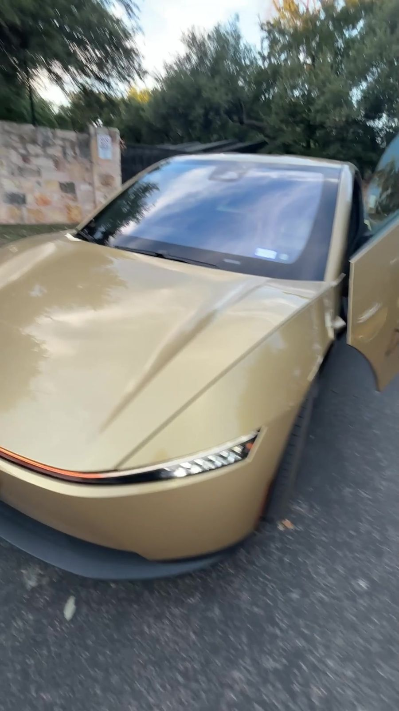
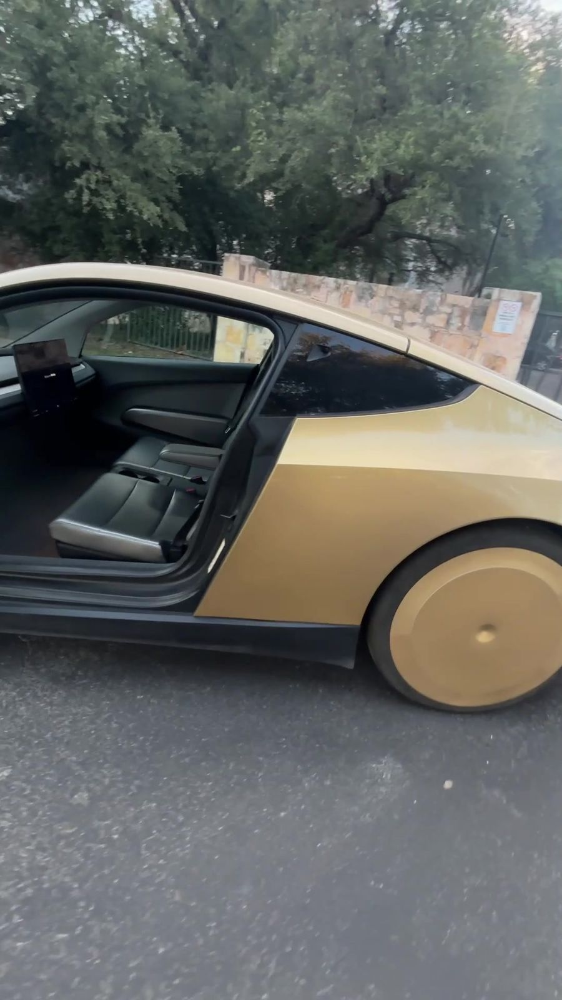
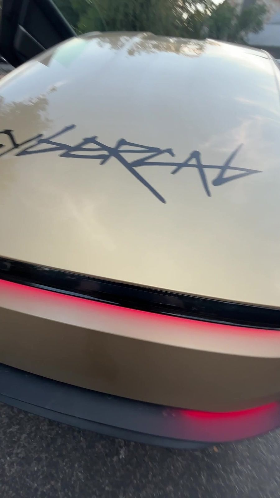
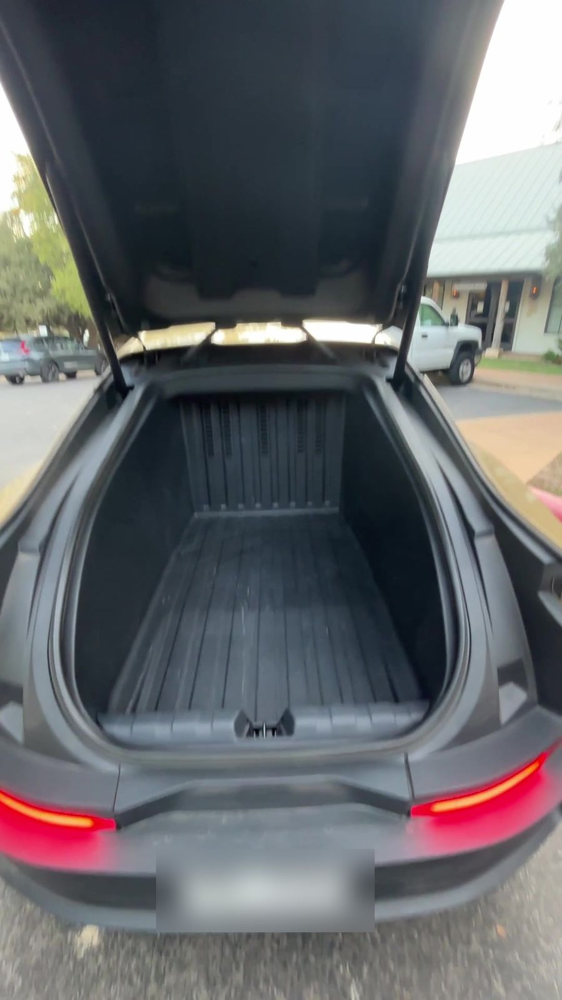
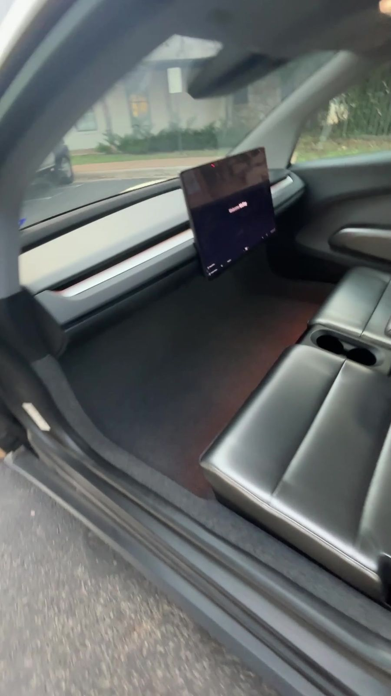
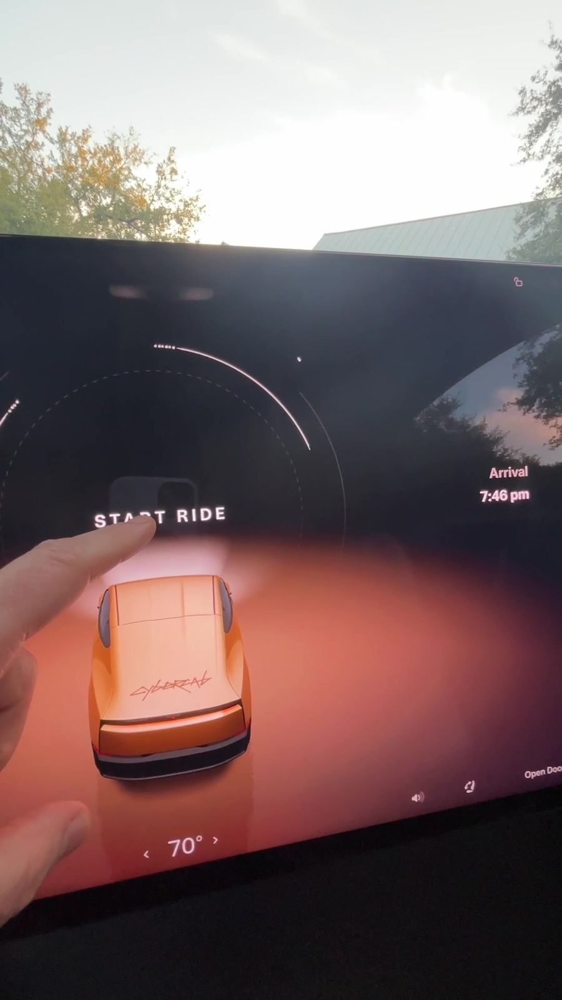
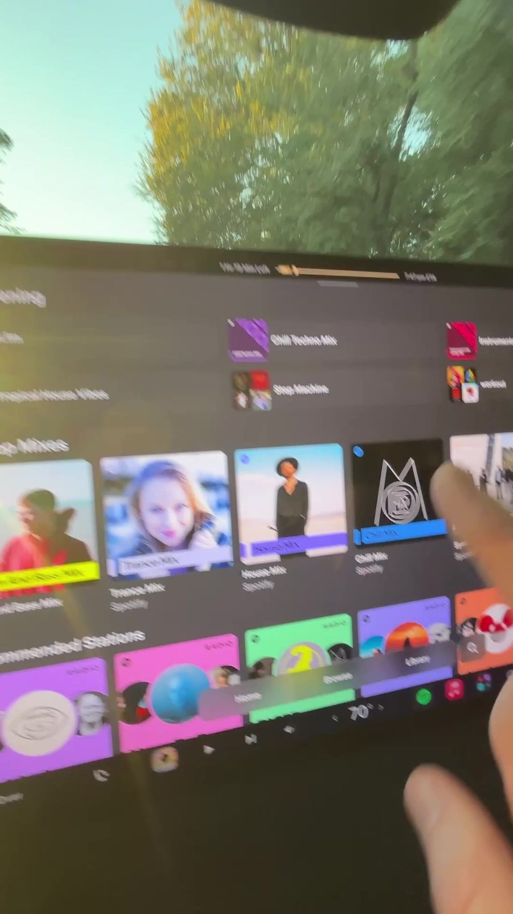
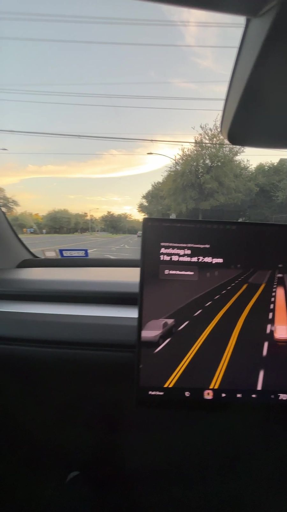
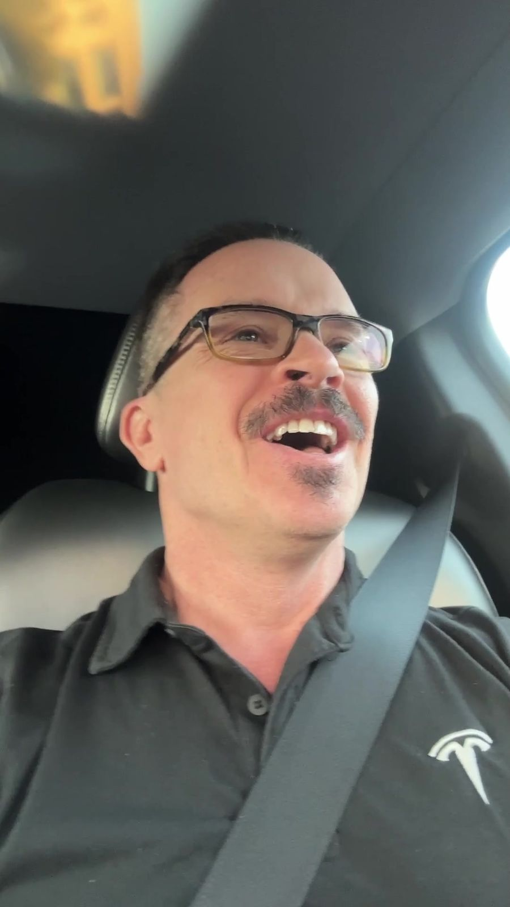
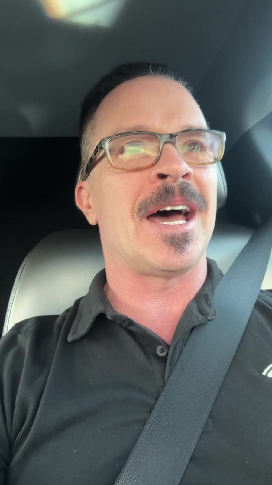

**October 31, 2026.** I posted a new reel. A little gold car. No driver. No steering wheel.

My caption: "Tesla Cybercab Robotaxi first ride in Austin 🚕 Great... but then FAIL 😂"

Here's the whole story. The good, the funny, and why I still want a fleet of these.

*My Cybercab, waiting for me in Austin. Still from my own footage. Watch [my Instagram reel](https://www.instagram.com/mckaystewart/reel/DfLEt73yrXQ/) or [the full ride on YouTube](https://youtu.be/YE_CufjOqTI).*

## "Okay, no driver"

That's the first thing I said on camera. "Okay, no driver, those little gold car."

Then it did something I didn't expect.

"Oh it opened the door for me, that's cool, I thought I was gonna have to open it."

That's on purpose. Tesla's [Cybercab rider guide](https://www.tesla.com/robotaxi/riderguides/cybercab/en_us/GUID-B2926138-4595-4C53-8C85-54EEED4CB7AF.html) says a door **opens automatically** when the car detects the rider's phone.

*Door up, seats ready. Still from my own footage, [full ride on YouTube](https://youtu.be/YE_CufjOqTI).*

## No paint. On purpose.

Look close at the body. It's not painted.

"This is like how the panels come, they're already colored," I said. "The purpose is of course to reduce cost."

[InsideEVs reported](https://insideevs.com/news/807100/tesla-cybercab-robotaxi-public-rides-austin-official/) the same thing. The color is built into the material when it's molded. No paint booth needed.

*That CYBERCAB script on the back. Still from my own footage, [Instagram reel](https://www.instagram.com/mckaystewart/reel/DfLEt73yrXQ/).*

## The trunk

I wanted to open the trunk. I had no clue how.

"Hopefully it doesn't leave without me," I joked.

Turns out "it's just a button in the app, which is cool."

And it's big. "You could fit either a small family or lots of luggage back here."

Tesla's [trunk page](https://www.tesla.com/robotaxi/riderguides/cybercab/en_us/GUID-8E4E4A77-7D50-48BE-9A6D-F07D7FDA1EF6.html) and [rider guide](https://www.tesla.com/robotaxi/riderguides/cybercab/en_us/Cybercab-Rider-Guide.pdf) give the real numbers:

- **20.2 cubic feet** of space
- Holds up to **220 pounds**
- Fits **2 checked bags and 2 carry-ons**
- **No front trunk** at all

*Lots of room back there. Still from my own footage, [full ride on YouTube](https://youtu.be/YE_CufjOqTI).*

## No pedals. No steering wheel.

I hopped in. The seats felt "sturdy, nice, luxurious." The floor is carpeted.

And up front? "No pedals, no steering wheel."

Just a big screen.

*Where the steering wheel would be. Nothing. Still from my own footage, [Instagram reel](https://www.instagram.com/mckaystewart/reel/DfLEt73yrXQ/).*

Once I buckled up, a **Start Ride** button popped up. That's how Tesla built it. The rider guide says the door closes after you buckle, and then you tap Start Ride.

"Oh my god, this is so cool."

*The big moment. Still from my own footage, [full ride on YouTube](https://youtu.be/YE_CufjOqTI).*

## My Spotify just... showed up

I tapped Spotify to see what would happen.

"Oh damn, it automatically loaded my Spotify list, that is sick."

Tesla's [Robotaxi page](https://www.tesla.com/robotaxi) says you can stream by "automatically signing into your preferred streaming services through your Robotaxi account." And the rider guide says your data is **removed** when the trip ends.

I went with an instrumental chill lounge mix. Of course.

*My playlists, already loaded. Still from my own footage, [full ride on YouTube](https://youtu.be/YE_CufjOqTI).*

*Smooth ride, sunset ahead. Still from my own footage, [Instagram reel](https://www.instagram.com/mckaystewart/reel/DfLEt73yrXQ/).*

## Then... the FAIL 😂

Two small bumps first.

The car couldn't come into my pickup area, so I walked **seven minutes** to meet it. And it took **29 minutes** to show up. "They're obviously in high demand."

I could've gotten a Model Y way faster. "But who wants to take a Model Y when you can take a Cybercab?"

Then I looked at the screen.

"I just noticed it was scheduled to drop me off in about two hours. And it's only about half an hour away."

My caption says it best: routing tried to turn a **20 min ride into 1 hr 40**. It wanted to take me "all the way to the other side of town."

So I called support. They gave me a **refund**. I called an Uber. And they said I could chill in the Cybercab until my Uber came. "Which is great."

*Me, finding out about my two-hour scenic route. Still from my own footage, [full ride on YouTube](https://youtu.be/YE_CufjOqTI).*

## Would I ride again? Heck yes.

"Obviously not a great first impression" on the route, I said. "But overall, like, super, super cool."

Early tech has hiccups. That's how it works. I think Tesla will figure this out.

## How the Cybercab got here

Quick timeline.

**October 10, 2024.** Elon Musk unveiled the Cybercab at Tesla's "We, Robot" event at **Warner Bros. Studios in Burbank, California**. He rode up to the stage in one. [Reuters](https://www.reuters.com/technology/teslas-musk-unveil-robotaxis-amid-fanfare-skepticism-2024-10-10/) reported **two gull-wing doors**, **no steering wheel or pedals**, production planned from **2026**, and a price **under $30,000**.

**June 22, 2025.** Tesla's Robotaxi service started in Austin. [Reuters](https://www.reuters.com/business/autos-transportation/tesla-tiptoes-into-long-promised-robotaxi-service-2025-06-22/) said about **10 Model Y** cars carried invited riders. [AP](https://apnews.com/article/tesla-selfdriving-robotaxis-musk-waymo-austin-autonomous-d50749e288dc50ceff44b8e6a4b64961) noted the **$4.20** flat fare.

**February 2026.** The first Cybercabs were built at Tesla's Gigafactory in Austin. Continuous production began in **April 2026**, per [The Verge](https://www.theverge.com/transportation/918106/tesla-cybercab-production-robotaxi-elon-musk-earnings).

**September 3, 2026.** Tesla said it was offering Cybercab rides in "limited areas of Austin, Texas," [Reuters reported](https://www.reuters.com/business/autos-transportation/teslas-cybercab-event-set-thursday-with-few-details-2026-09-03/). Tesla's post on X that day, [via Engadget](https://www.engadget.com/2250874/tesla-offering-cybercab-robotaxi-rides/): "The future has arrived in Austin." Texas records showed **45** Cybercabs.

That means my ride was in one of a pretty small group of cars. Super lucky.

## Why I want a fleet

Here's the part I'm most excited about.

At the unveiling, Musk said self-driving cars could earn their owners money by giving rides, [the BBC reported](https://www.bbc.com/news/articles/cm29x5ke9jdo).

Right now the Austin Cybercabs are owned by Tesla. They're not for sale yet. But [Engadget reported](https://www.engadget.com/2250874/tesla-offering-cybercab-robotaxi-rides/) Tesla is taking inquiries from people who want to help "build its robotaxi network."

On camera I said it plainly: "I can't wait to buy a fleet of these and have them out, making money for me, my little robot army."

My guess on timing? In the video I said "anyone will be able to buy these when full self-driving unsupervised launches." That's Tesla's FSD (Full Self-Driving) software running with no human watching. "I think it will take at least another eight months. Hopefully, I'm wrong."

Will be buying. Prob a fleet. Let's go passive income.

*So. Freaking. Cool. Still from my own footage, [Instagram reel](https://www.instagram.com/mckaystewart/reel/DfLEt73yrXQ/).*

## Watch the whole ride

<iframe src="https://www.youtube-nocookie.com/embed/YE_CufjOqTI" title="My first Cybercab ride!" style="position:absolute;top:0;left:0;width:100%;height:100%;border:0;" allow="accelerometer; clipboard-write; encrypted-media; gyroscope; picture-in-picture" allowfullscreen loading="lazy"></iframe>

*["My first Cybercab ride!"](https://youtu.be/YE_CufjOqTI) on my YouTube channel. Shot by me in Austin, Texas. The short version is [my Instagram reel](https://www.instagram.com/mckaystewart/reel/DfLEt73yrXQ/).*

So. Freaking. Cool. LFG (that's "let's go," with extra hype) Elon!!

Now you tell me. **Would you ride in a car with no driver?** 👇

## Sources

- [Tesla: Ride with Cybercab (rider guide)](https://www.tesla.com/robotaxi/riderguides/cybercab/en_us/GUID-B2926138-4595-4C53-8C85-54EEED4CB7AF.html)
- [Tesla: Open the Trunk (rider guide)](https://www.tesla.com/robotaxi/riderguides/cybercab/en_us/GUID-8E4E4A77-7D50-48BE-9A6D-F07D7FDA1EF6.html)
- [Tesla: Cybercab Rider Guide PDF, published September 22, 2026](https://www.tesla.com/robotaxi/riderguides/cybercab/en_us/Cybercab-Rider-Guide.pdf)
- [Tesla: Robotaxi](https://www.tesla.com/robotaxi)
- [Reuters: Tesla CEO Elon Musk unveils 'Cybercab' robotaxi, October 11, 2024](https://www.reuters.com/technology/teslas-musk-unveil-robotaxis-amid-fanfare-skepticism-2024-10-10/)
- [BBC: Tesla robotaxi: Cybercab unveiled by Elon Musk, October 2024](https://www.bbc.com/news/articles/cm29x5ke9jdo)
- [Reuters: Tesla rolls out robotaxis in Texas test, June 23, 2025](https://www.reuters.com/business/autos-transportation/tesla-tiptoes-into-long-promised-robotaxi-service-2025-06-22/)
- [AP: Musk finally rolls out his driverless Tesla taxis, June 22, 2025](https://apnews.com/article/tesla-selfdriving-robotaxis-musk-waymo-austin-autonomous-d50749e288dc50ceff44b8e6a4b64961)
- [The Verge: Tesla's Cybercab goes into production, April 24, 2026](https://www.theverge.com/transportation/918106/tesla-cybercab-production-robotaxi-elon-musk-earnings)
- [Reuters: Tesla starts Cybercab rides in Austin, September 3, 2026](https://www.reuters.com/business/autos-transportation/teslas-cybercab-event-set-thursday-with-few-details-2026-09-03/)
- [InsideEVs: Tesla's Cybercab is finally giving paid robotaxi rides, September 4, 2026](https://insideevs.com/news/807100/tesla-cybercab-robotaxi-public-rides-austin-official/)
- [Engadget: Tesla starts offering Cybercab robotaxi rides, September 4, 2026](https://www.engadget.com/2250874/tesla-offering-cybercab-robotaxi-rides/)
- [My Instagram reel, October 31, 2026](https://www.instagram.com/mckaystewart/reel/DfLEt73yrXQ/)
- [My full ride on YouTube: "My first Cybercab ride!"](https://youtu.be/YE_CufjOqTI)
