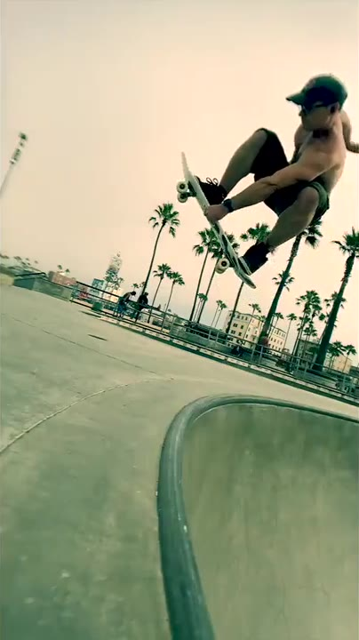
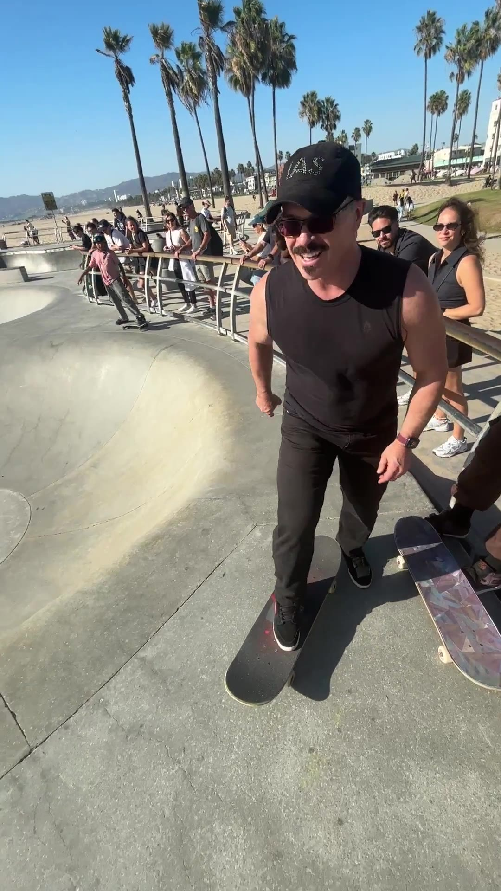

**November 4, 2026.** I posted a new clip. Me, back on the **snake run** at Venice Beach Skatepark.

My caption: "Venice Skate Park snake run, so fun... Thanks @sheepishskater for the video you rule!"

And they do rule. Watch.

<video controls muted playsinline preload="metadata" poster="/assets/images/2026-11-07/venice-snake-run-nov-2026.jpg" style="width:100%;height:auto;"><source src="/assets/images/2026-11-07/venice-snake-run-nov-2026.mp4" type="video/mp4"></video>
*My snake run at Venice Beach Skatepark. Video by [@sheepishskater](https://www.instagram.com/sheepishskater/). From my [Instagram reel on November 4, 2026](https://www.instagram.com/reel/DfVdBm0Sx-O/) and my [X post on November 5, 2026](https://x.com/i/status/2118322272578449776).*

A **snake run** is a long, winding concrete path. It twists like a snake. You ride it by **carving**, which means leaning into long, smooth turns from one wall to the other.

No big tricks needed. Just flow.

## Same run, five years later

I've been skating this exact run since **2021**. That was my first year on a board.

**July 30, 2021.** A frontside grab air-out at the bottom of the snake run. I called it "#ExhiliratingTerror." ([Read about year one.](/2026/10/26/from-first-ollie-to-first-grind-my-year-learning-to-skate-venice/))

*Snake run, July 2021. From my [X post on July 30, 2021](https://x.com/mckaystewart/status/1421213074808184834).*

**March 14, 2022.** My friend **@kylejetter** filmed me fisheye, skating right behind me. A **fisheye** is a super-wide lens. I called it "my best run to date." ([Read about year two.](/2026/10/29/year-two-on-wheels-my-2022-skate-progression/))

<video controls muted playsinline preload="metadata" poster="/assets/images/2026-10-29/fisheye-snake-run-mar-2022.jpg" style="width:100%;height:auto;"><source src="/assets/images/2026-10-29/fisheye-snake-run-mar-2022.mp4" type="video/mp4"></video>
*Fisheye snake run, filmed by @kylejetter. From my [X post on March 14, 2022](https://x.com/mckaystewart/status/1503365633563451394).*

**May 19, 2025.** Back in LA, back on the snake. My caption: "Heaven is... skating Venice Skate Park, improving, snake run. Thanks Kyle!" ([Read about years three to six.](/2026/10/30/years-three-to-six-on-wheels-pump-tracks-gaps-and-120fps-slow-mo/))

<video controls muted playsinline preload="metadata" poster="/assets/images/2026-10-30/venice-snake-run-may-2025.jpg" style="width:100%;height:auto;"><source src="/assets/images/2026-10-30/venice-snake-run-may-2025.mp4" type="video/mp4"></video>
*Snake run, May 2025. From my [X post on May 19, 2025](https://x.com/mckaystewart/status/1924675454125936788).*

And now **November 2026**. Five years in. Still smiling.

*Rolling in, November 2026. Still from the video by @sheepishskater.*

Look at that crowd on the rail. That's a normal day at Venice.

So why is this park such a big deal? Here's the real history.

## Dogtown came first

Long before the park, there was **Dogtown**.

That was the nickname for a run-down beach area on the border of **Santa Monica and Venice**, per the [Los Angeles Times](https://www.latimes.com/archives/la-xpm-2001-jan-24-cl-16048-story.html).

In **1971**, Jeff Ho, Skip Engblom and Craig Stecyk opened a surf shop on Main Street in Santa Monica. Its name: **Jeff Ho Surfboards and Zephyr Productions**. The city made the building a landmark in **2007** ([Wikipedia](https://en.wikipedia.org/wiki/Jeff_Ho_Surfboards_and_Zephyr_Productions)).

The shop's skate team was the **Zephyr team**. Everyone called them the **Z-Boys**.

The Z-Boys were **11** teenage boys and **1** girl, per the [Smithsonian's National Museum of American History](https://americanhistory.si.edu/explore/stories/boys-dogtown). They skated like they surfed. Low, fast, aggressive.

During a record California drought in the **1970s**, backyard pools sat empty. Those pools became the Z-Boys' spots ([Wikipedia](https://en.wikipedia.org/wiki/Dogtown_and_Z-Boys)). That pushed skating **vertical**, up the walls and into the air. Skaters call that **vert**.

Team member **Stacy Peralta** later told the story himself. He directed the documentary ***Dogtown and Z-Boys***. It won **2** awards at the **2001** Sundance Film Festival: the Audience Award and the Directing Award ([Wikipedia](https://en.wikipedia.org/wiki/Dogtown_and_Z-Boys)).

## A park, 10 years in the making

Venice had the history. But for years, it had no real skatepark.

Locals pushed for one for about **a decade**, starting when the city began renovating Venice Beach in **1999**, per the [Los Angeles Times](https://www.latimes.com/archives/la-xpm-2009-oct-04-me-venice-skate-park4-story.html).

Pro skater **Jesse Martinez** and the **Venice Surf and Skateboard Association**, a local skater group, made it happen ([PBS SoCal](https://www.pbssocal.org/shows/departures/venice-beach-dennis-agnew-memorial-skate-park)).

The park finally opened on **Saturday, October 3, 2009**.

Here's who cut the ribbon, per [LA Recreation and Parks](https://laparks.blogspot.com/2009/10/):

- Then-Mayor **Antonio Villaraigosa**
- Then-Councilmember **Bill Rosendahl**
- Pro skaters and Venice legends **Jesse Martinez**, **Jay Adams** and **Tony Alva**

Adams and Alva were original Z-Boys. Dogtown, back on its home turf.

## The numbers

From [LA Recreation and Parks](https://laparks.blogspot.com/2009/10/) and the [Los Angeles Times](https://www.latimes.com/archives/la-xpm-2009-oct-04-me-venice-skate-park4-story.html):

- **16,000** square feet
- **$3.4 million** to build, paid by selling extra city land in Venice plus development fees, not the city's main budget
- **9 feet** deep at the deep pool
- **4** main parts: deep pool, street course, snake run, flow bowl
- The city's **12th** skate park at the time

Its official name honors a Z-Boy. It's the **Dennis "Polar Bear" Agnew Memorial Skatepark** ([PBS SoCal](https://www.pbssocal.org/shows/departures/venice-beach-dennis-agnew-memorial-skate-park)).

## Why the snake run is special

The city calls the snake run the **"old school"** part of the park. You "carve from bank to bank," per [LA Recreation and Parks](https://laparks.blogspot.com/2009/10/).

It's a throwback to **1970s** skatepark design. It starts as a **3-foot** basin and ends in a **7-foot** kidney-shaped half bowl, per [Surfer Today](https://www.surfertoday.com/skateboarding/the-story-of-venice-beach-skatepark).

At the opening, city engineer **Gary Lee Moore** said the snake was his favorite. His reason: "It's where you'll find the 5-year-olds and the 55-year-olds" ([Los Angeles Times](https://www.latimes.com/archives/la-xpm-2009-oct-04-me-venice-skate-park4-story.html)).

That's exactly why I love it. I started skating as a grown man. Nobody there cared. Kids gave me tips.

## The year it filled with sand

One wild footnote.

In **April 2020**, during the COVID-19 pandemic's stay-at-home orders, city crews used a bulldozer to dump sand into the park. The goal was to keep crowds out ([Patch](https://patch.com/california/venice/coronavirus-venice-beach-skate-park-filled-sand)).

In **late May 2020**, local volunteers grabbed shovels and dug it back out ([CBS Sports](https://www.cbssports.com/general/news/skateboarders-remove-sand-from-iconic-venice-beach-skate-park-despite-stay-at-home-orders/)).

That's how much this concrete means to people.

## What I take from it

I'm an actor and a stuntman. Flow, balance and calm under speed are my job.

The snake run trains all three. One lap at a time.

Huge thanks to **@sheepishskater** for filming. You rule.

Now you tell me. **Have you ever skated Venice?** 👇

## Sources

- My [Instagram reel, November 4, 2026](https://www.instagram.com/reel/DfVdBm0Sx-O/), and [X post, November 5, 2026](https://x.com/i/status/2118322272578449776)
- My X posts: [Jul 30, 2021](https://x.com/mckaystewart/status/1421213074808184834); [Mar 14, 2022](https://x.com/mckaystewart/status/1503365633563451394); [May 19, 2025](https://x.com/mckaystewart/status/1924675454125936788)
- [LA Parks News and Information, October 2009](https://laparks.blogspot.com/2009/10/), City of Los Angeles Department of Recreation and Parks
- ["Cut the ribbon, shred the course"](https://www.latimes.com/archives/la-xpm-2009-oct-04-me-venice-skate-park4-story.html), Los Angeles Times, October 4, 2009
- ["Flying High Out of the Debris of Dogtown"](https://www.latimes.com/archives/la-xpm-2001-jan-24-cl-16048-story.html), Los Angeles Times, January 24, 2001
- ["The boys of Dogtown"](https://americanhistory.si.edu/explore/stories/boys-dogtown), Smithsonian National Museum of American History
- ["Venice Beach: Dennis Agnew Memorial Skate Park"](https://www.pbssocal.org/shows/departures/venice-beach-dennis-agnew-memorial-skate-park), PBS SoCal, March 25, 2010
- ["The birth of the Venice Beach Skatepark"](https://www.surfertoday.com/skateboarding/the-story-of-venice-beach-skatepark), Surfer Today
- ["Coronavirus: Venice Beach Skate Park Filled With Sand"](https://patch.com/california/venice/coronavirus-venice-beach-skate-park-filled-sand), Patch, April 17, 2020
- ["Skateboarders remove sand from iconic Venice Beach skate park"](https://www.cbssports.com/general/news/skateboarders-remove-sand-from-iconic-venice-beach-skate-park-despite-stay-at-home-orders/), CBS Sports, May 2020
- ["Dogtown and Z-Boys"](https://en.wikipedia.org/wiki/Dogtown_and_Z-Boys) and ["Jeff Ho Surfboards and Zephyr Productions"](https://en.wikipedia.org/wiki/Jeff_Ho_Surfboards_and_Zephyr_Productions), Wikipedia
