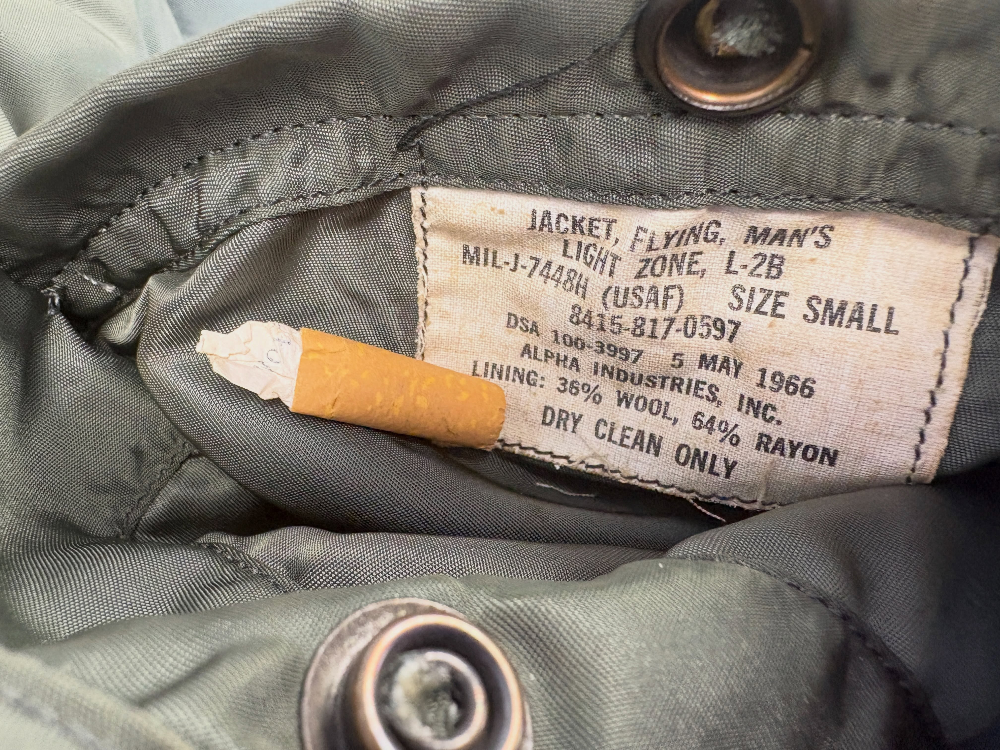
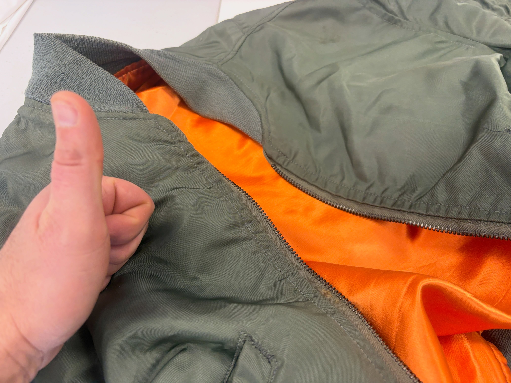
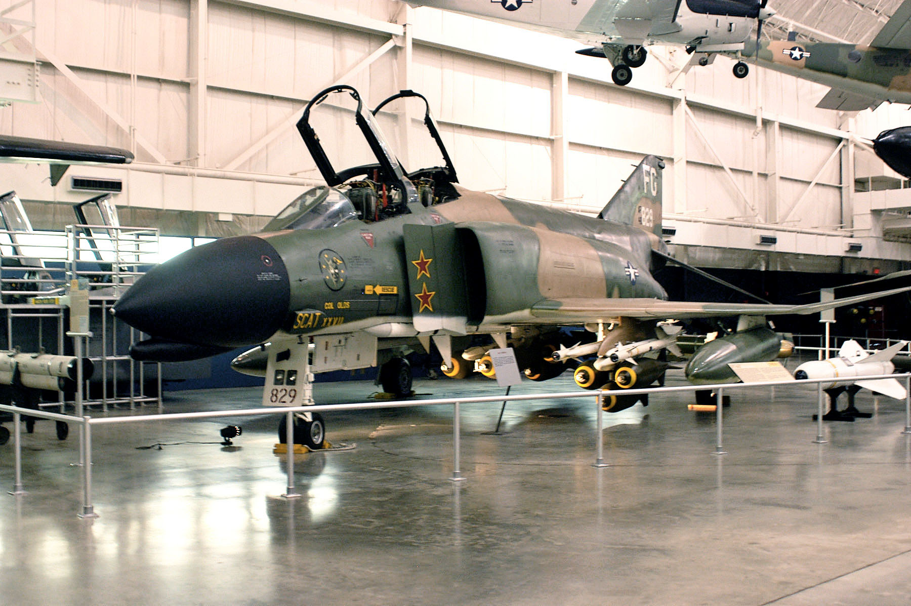

**November 2, 2026.** I posted two photos of my dad's jacket.

My caption: "Vietnam War era cigarette butt anyone? Didn't know my dad smoked the little devil… his original F4 fighter jacket. My dad's so cool."

*Inside the jacket: the original U.S. Air Force tag, and a cigarette I never expected to find. From my [Instagram post on November 2, 2026](https://www.instagram.com/p/DfPlSlQoJKQ/).*

Look at that tag. It is not a replica sewn in later. It is the military specification label, still stitched in place.

## What the tag says

I can read every line:

- **JACKET, FLYING, MAN'S**
- **LIGHT ZONE, L-2B**
- **MIL-J-7448H (USAF)**
- Size **SMALL**
- Stock number **8415-817-0597**
- **DSA 100-3997**
- **5 MAY 1966**
- **ALPHA INDUSTRIES, INC.**
- Lining: **36%** wool, **64%** rayon
- Dry clean only

So this is a U.S. Air Force flying jacket. The type on the tag is **L-2B**. The specification is **MIL-J-7448H**. The contract date is **May 5, 1966**.

That date sits right in the Vietnam War.

The letters **DSA** stand for the **Defense Supply Agency**, the Pentagon office that bought supplies for the military. It formed on **October 1, 1961**, began work on **January 1, 1962**, and was renamed the Defense Logistics Agency on **January 1, 1977** ([DLA history](https://www.dla.mil/About-DLA/History/)).

The tag names the jacket, not a person. What I can prove is right there in the stitching. What I posted is the rest: this is my dad's original F-4 fighter jacket.

*Sage-green shell, bright orange lining, metal zipper, knit collar. Same jacket. From my [Instagram post on November 2, 2026](https://www.instagram.com/p/DfPlSlQoJKQ/).*

The outside is worn olive green. The inside is a vivid orange. The zipper is metal. The collar is knit. A thumbs-up felt right.

## The jet on the name

I called it his original **F-4 fighter jacket**. The F-4 is the **Phantom II**.

[McDonnell Aircraft Company](https://www.history.navy.mil/content/history/museums/nnam/explore/collections/aircraft/f/f-4n-phantom-ii.html) built it for the U.S. Navy. The job: defend aircraft carriers. It had to climb high and hit attacking planes with long-range missiles.

The prototype, the **XF4H-1**, made its first flight on **May 27, 1958**. [Naval History and Heritage Command](https://www.history.navy.mil/content/history/nhhc/today-in-history/may-27.html) later called that prototype "perhaps the most successful fighter aircraft ever built."

Navy and Marine squadrons started getting Phantoms in **1960**. The Air Force's first version, the **F-4C**, first flew in **May 1963**. Deliveries began **six months** later, in **November 1963** ([National Museum of the U.S. Air Force](https://www.nationalmuseum.af.mil/Visit/Museum-Exhibits/Fact-Sheets/Display/Article/2929390/mcdonnell-douglas-f-4c-phantom-ii/)).

It has two seats, one behind the other. A **pilot** flew the jet. In back sat a second crew member who ran the radar and the weapons. The Navy and Marines called that person a **radar intercept officer**, or **RIO**. The Air Force called the same job a **weapons system officer**, or **WSO** ([Tinker Air Force Base](https://www.tinker.af.mil/News/Article-Display/Article/1240944/tinker-history-mcdonnell-douglas-f-4-phantom-ii/); [Naval Aviation Museum](https://www.history.navy.mil/content/history/museums/nnam/explore/collections/aircraft/f/f-4n-phantom-ii.html)).

Two General Electric **J79** engines pushed it. The Air Force museum lists the F-4C's top speed at **1,400 mph**. A museum fact sheet on the J79 says the F-4 could fly at **Mach 2**, which means twice the speed of sound ([NMUSAF F-4C](https://www.nationalmuseum.af.mil/Visit/Museum-Exhibits/Fact-Sheets/Display/Article/2929390/mcdonnell-douglas-f-4c-phantom-ii/); [NMUSAF J79](https://www.nationalmuseum.af.mil/Visit/Museum-Exhibits/Fact-Sheets/Display/Article/197630/general-electric-j79-turbojet/)).

Early F-4s had no gun inside the plane. Planners thought future fights would be missile-only. It could hang up to **16,000 pounds** of weapons under the wings and body ([Naval Aviation Museum](https://www.history.navy.mil/content/history/museums/nnam/explore/collections/aircraft/f/f-4n-phantom-ii.html)).

From **1958 to 1979**, builders finished **5,195** Phantom IIs ([Naval Aviation Museum](https://www.history.navy.mil/content/history/museums/nnam/explore/collections/aircraft/f/f-4n-phantom-ii.html)). The Air Force museum says more than **2,600** went to the USAF and about **1,200** to the Navy and Marine Corps.

*The F-4C Phantom II on display at the [National Museum of the U.S. Air Force](https://www.nationalmuseum.af.mil/Visit/Museum-Exhibits/Fact-Sheets/Display/Article/2929390/mcdonnell-douglas-f-4c-phantom-ii/). On **May 20, 1967**, Col. Robin Olds and weapons system officer Lt. Stephen Croker destroyed two MiG-17s in one day in this jet. U.S. Air Force photo, [public domain](https://www.nationalmuseum.af.mil/Upcoming/Photos/igphoto/2000574329/).*

## What it did in Vietnam

The Navy, Marines and Air Force all flew the F-4 in the Vietnam War.

In **1965**, the Air Force sent its first F-4Cs to Southeast Asia. They fought North Vietnamese fighters and hit ground targets ([NMUSAF F-4C](https://www.nationalmuseum.af.mil/Visit/Museum-Exhibits/Fact-Sheets/Display/Article/2929390/mcdonnell-douglas-f-4c-phantom-ii/)).

The F-4 became the Air Force's "primary counter to the MiG" ([NMUSAF, Countering MiGs](https://www.nationalmuseum.af.mil/Visit/Museum-Exhibits/Fact-Sheets/Display/Article/196005/countering-migs-air-to-air-combat-over-north-vietnam/)). A **MiG** was the main enemy fighter the North Vietnamese flew.

It also dropped bombs. In that role, the Air Force museum says an F-4C "could carry twice the normal load of a WWII B-17."

Camera-equipped **RF-4Cs** arrived too. The first production RF-4C flew on **May 18, 1964**. In **October 1965**, the 16th Tactical Reconnaissance Squadron took them to Southeast Asia ([NMUSAF RF-4C](https://www.nationalmuseum.af.mil/Visit/Museum-Exhibits/Fact-Sheets/Display/Article/195876/mcdonnell-douglas-rf-4c-phantom-ii/)).

By **1968**, F-4s at Ubon, Thailand, were doing **Fast FAC** work under the call sign Wolf. FAC means **forward air control**: find a target, mark it, and talk other planes onto it ([NMUSAF, Fast FACs](https://www.nationalmuseum.af.mil/Visit/Museum-Exhibits/Fact-Sheets/Display/Article/195935/fac-in-sea-fast-facs/)).

**Wild Weasels** had an even harder job. They found and attacked enemy air defenses, especially surface-to-air missile sites — **SAMs** — and the radars that guided those missiles ([NMUSAF, What is a Wild Weasel?](https://www.nationalmuseum.af.mil/Visit/Museum-Exhibits/Fact-Sheets/Display/Article/197493/what-is-a-wild-weasel/)).

On **July 24, 1965**, an SA-2 shot down a USAF F-4C. It was the first of **110** USAF aircraft lost to SAMs in Southeast Asia ([NMUSAF, Wild Weasels vs. SAMs](https://www.nationalmuseum.af.mil/Visit/Museum-Exhibits/Fact-Sheets/Display/Article/196014/first-in-last-out-wild-weasels-vs-sams/)).

F-4C Wild Weasels finally reached the field in **spring 1969**. In **September 1972**, six of them from the 67th Tactical Fighter Squadron went to Korat, Thailand. Those crews flew **460** sorties in Southeast Asia without a loss ([NMUSAF, Linebacker](https://www.nationalmuseum.af.mil/Visit/Museum-Exhibits/Fact-Sheets/Display/Article/197482/wild-weasels-and-linebacker-operations-the-war-ends/)).

Navy and Marine F-4 crews scored **36** kills by the end of the war ([Naval Aviation Museum](https://www.history.navy.mil/content/history/museums/nnam/explore/collections/aircraft/f/f-4n-phantom-ii.html)). The last U.S. aces — crews credited with **five** or more kills — earned that status in F-4s ([Tinker AFB](https://www.tinker.af.mil/News/Article-Display/Article/1240944/tinker-history-mcdonnell-douglas-f-4-phantom-ii/)).

The last Navy and Marine Phantoms retired in **January 1992**, about **31 years** after the jet first reached the fleet ([Naval Aviation Museum](https://www.history.navy.mil/content/history/museums/nnam/explore/collections/aircraft/f/f-4n-phantom-ii.html)).

## The little devil

I did not know my dad smoked.

The cigarette I found has a tan filter. No brand name is left to read. I called it "the little devil."

For decades the U.S. military issued tobacco to troops. A **1982** Defense Department rations report still listed cigarettes in the Sundries Pack, a kit of comfort items for units far from a base store ([U.S. Army Natick report, via Internet Archive](https://archive.org/details/DTIC_ADA127795)). A **2009** study in the *American Journal of Public Health* says the military suspended cigarette rations in **1975** ([Smith and Malone](https://www.ncbi.nlm.nih.gov/pmc/articles/PMC2724442/)).

A Vietnam-era cigarette in a **1966** flying jacket fits that history.

## Why I posted it

The Phantom II first flew **eight years** before this jacket's contract date. By May 1966, F-4s were already in combat.

This jacket outlasted the war. It outlasted the cigarette. It made it all the way to me.

My dad's so cool.

Have you ever found something hidden in a family jacket? Tell me below.

## Sources

- My [Instagram post, November 2, 2026](https://www.instagram.com/p/DfPlSlQoJKQ/)
- The jacket's sewn-in label: JACKET, FLYING, MAN'S / LIGHT ZONE, L-2B / MIL-J-7448H (USAF) / SIZE SMALL / 8415-817-0597 / DSA 100-3997 / 5 MAY 1966 / ALPHA INDUSTRIES, INC.
- [History of DLA](https://www.dla.mil/About-DLA/History/), Defense Logistics Agency
- [McDonnell Douglas F-4C Phantom II](https://www.nationalmuseum.af.mil/Visit/Museum-Exhibits/Fact-Sheets/Display/Article/2929390/mcdonnell-douglas-f-4c-phantom-ii/), National Museum of the U.S. Air Force
- [General Electric J79 Turbojet](https://www.nationalmuseum.af.mil/Visit/Museum-Exhibits/Fact-Sheets/Display/Article/197630/general-electric-j79-turbojet/), National Museum of the U.S. Air Force
- [McDonnell Douglas RF-4C Phantom II](https://www.nationalmuseum.af.mil/Visit/Museum-Exhibits/Fact-Sheets/Display/Article/195876/mcdonnell-douglas-rf-4c-phantom-ii/), National Museum of the U.S. Air Force
- [Countering MiGs: Air-to-Air Combat Over North Vietnam](https://www.nationalmuseum.af.mil/Visit/Museum-Exhibits/Fact-Sheets/Display/Article/196005/countering-migs-air-to-air-combat-over-north-vietnam/), National Museum of the U.S. Air Force
- [First In, Last Out: Wild Weasels vs. SAMs](https://www.nationalmuseum.af.mil/Visit/Museum-Exhibits/Fact-Sheets/Display/Article/196014/first-in-last-out-wild-weasels-vs-sams/), National Museum of the U.S. Air Force
- [What is a Wild Weasel?](https://www.nationalmuseum.af.mil/Visit/Museum-Exhibits/Fact-Sheets/Display/Article/197493/what-is-a-wild-weasel/), National Museum of the U.S. Air Force
- [Wild Weasels and Linebacker Operations: The War Ends](https://www.nationalmuseum.af.mil/Visit/Museum-Exhibits/Fact-Sheets/Display/Article/197482/wild-weasels-and-linebacker-operations-the-war-ends/), National Museum of the U.S. Air Force
- [FAC in SEA: Fast FACs](https://www.nationalmuseum.af.mil/Visit/Museum-Exhibits/Fact-Sheets/Display/Article/195935/fac-in-sea-fast-facs/), National Museum of the U.S. Air Force
- [F-4N Phantom II](https://www.history.navy.mil/content/history/museums/nnam/explore/collections/aircraft/f/f-4n-phantom-ii.html), National Naval Aviation Museum
- [This Day in Naval History, May 27](https://www.history.navy.mil/content/history/nhhc/today-in-history/may-27.html), Naval History and Heritage Command
- [Tinker History: McDonnell Douglas F-4 Phantom II](https://www.tinker.af.mil/News/Article-Display/Article/1240944/tinker-history-mcdonnell-douglas-f-4-phantom-ii/), Tinker Air Force Base, July 7, 2017
- U.S. Air Force photo of the museum F-4C, [NMUSAF photo 050804-F-1234P-001](https://www.nationalmuseum.af.mil/Upcoming/Photos/igphoto/2000574329/), public domain
- Meyer, Alice I., and Mary V. Klicka. [*Operational Rations — Current and Future of the Department of Defense*](https://archive.org/details/DTIC_ADA127795). NATICK/TR-82/031 (DTIC ADA127795), September 1982
- Smith, Elizabeth A., and Ruth E. Malone. ["'Everywhere the Soldier Will Be': Wartime Tobacco Promotion in the US Military"](https://www.ncbi.nlm.nih.gov/pmc/articles/PMC2724442/). *American Journal of Public Health* 99, no. 9 (September 2009): 1595–1602
