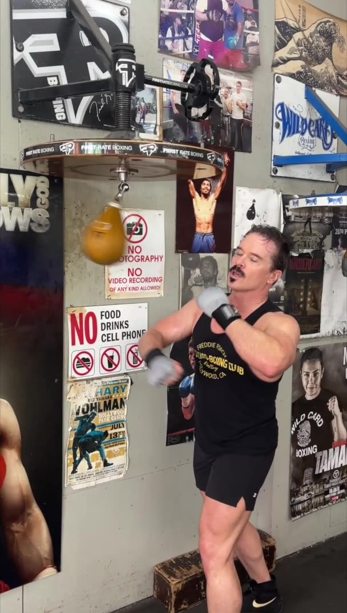

**Hollywood. Wild Card Boxing Club.** Hand wraps on, speed bag rattling, the red ring with the club logo across the canvas.

I posted the clip on November 19, 2026, with one question: anyone else ever train here? Then I started typing the backstory, and it turned into the craziest path of my life in two lines.

<iframe src="https://www.youtube-nocookie.com/embed/hN51EUCDze8" title="Training at Wildcard Boxing Gym in Hollywood, CA" style="position:absolute;top:0;left:0;width:100%;height:100%;border:0;" allow="accelerometer; clipboard-write; encrypted-media; gyroscope; picture-in-picture" allowfullscreen loading="lazy"></iframe>

*Training at Wild Card Boxing Club in Hollywood. Also on [X](https://x.com/mckaystewart/status/2123499376232550542) and [Instagram](https://www.instagram.com/reel/Df7y_hPSh14/).*

Here's the caption, word for word:

> "Putting in some work at Wild Card. Anyone else ever train here? 🥊
>
> Crazy path: stumbled onto JKD walking near my school LMU, trained under Inosanto, found Muay Thai there, trained at MTA , fought in a smoker, and once trained in the ring beside Pacquiao (thanks @bridgett_riley!)"

Let me unpack that.

## Step 1: I stumbled onto JKD near LMU

My school was **LMU**, which stands for **Loyola Marymount University** in Los Angeles. I was walking near campus and stumbled onto **JKD**.

JKD is **Jeet Kune Do**, Bruce Lee's martial art. The name translates to "way of the intercepting fist." It's a hybrid style built around stopping an opponent's attack with your own, and it pulls from Wing Chun, boxing, fencing and more ([Wikipedia, Jeet Kune Do](https://en.wikipedia.org/wiki/Jeet_Kune_Do)).

I didn't go looking for it. I just walked into it.

## Step 2: I trained under Inosanto

That led me to **Dan Inosanto**.

If you don't know the name: Bruce Lee appointed only three people to teach at his three Jun Fan Gung Fu institutes, and Inosanto was one of them. After Lee died, Inosanto became the main spokesperson and historian for Jeet Kune Do ([Wikipedia, Dan Inosanto](https://en.wikipedia.org/wiki/Dan_Inosanto)). He still teaches at the **Inosanto Academy of Martial Arts** in Marina del Rey, California ([Inosanto Academy](https://www.inosanto.com/)).

## Step 3: I found Muay Thai there

**Muay Thai** is Thai boxing: punches, kicks, knees and elbows. The Inosanto Academy teaches it alongside Jeet Kune Do and the Filipino arts. Its Thai boxing curriculum credits **Ajarn Surachai "Chai" Sirisute**, founder of the Thai Boxing Association of the USA ([Inosanto Academy curriculum](https://inosanto.com/academy-info/curriculum/)).

I came for Bruce Lee's art and found Muay Thai there too.

## Step 4: I trained at MTA

From there, I kept going with Muay Thai at **MTA**.

## Step 5: I fought in a smoker

Then I fought in a **smoker**. A smoker is an unofficial amateur bout. No title, no pro record. Just you, the other person and the ring.

## Step 6: The ring beside Pacquiao

And then there's Wild Card.

**Freddie Roach** opened Wild Card Boxing Club in Hollywood, and the gym marked **30 years** in May 2025. The Los Angeles Times called it "a cathedral" of boxing. Over those years, **42** fighters prepared there and went on to win world titles ([Los Angeles Times, May 16, 2025](https://www.latimes.com/sports/story/2025-05-16/freddie-roach-wild-card-gym-30-year-anniversary)).

The most famous of them is **Manny Pacquiao**. Same article: Pacquiao trained at Wild Card, worked with Roach, and went on to win titles in eight divisions. The gym got so crowded during his run that Roach took over the space downstairs as a second gym for Manny alone ([Los Angeles Times](https://www.latimes.com/sports/story/2025-05-16/freddie-roach-wild-card-gym-30-year-anniversary)).

I once trained in the ring right beside him.

## Thank you, Bridgett Riley

The thank-you in my caption goes to **Bridgett Riley** ([@bridgett_babydoll_riley](https://www.instagram.com/bridgett_babydoll_riley/) on Instagram).

Bridgett, nicknamed "Baby Doll," is a fighter and a stuntwoman. She won the **IFBA** (International Female Boxers Association) world bantamweight title on February 15, 1998, and she was inducted into the International Women's Boxing Hall of Fame in 2019. Her stunt career started as the double for the Yellow Ranger on *Mighty Morphin Power Rangers*, and she played a boxer in *Million Dollar Baby* ([Wikipedia, Bridgett Riley](https://en.wikipedia.org/wiki/Bridgett_Riley)). IMDb lists **59** stunt credits for her, with *Jumper*, *Transformers* and *Star Trek Beyond* among her known-for titles ([IMDb](https://www.imdb.com/name/nm0726994/)).

Thanks, Bridgett.

## Back at Wild Card

*Working the speed bag at Wild Card. Video still: McKay Stewart.*

Wild Card has been part of my story before. I shot fight shorts in the alley under the gym with David Wachs and Jasper Jeon: [I Choreographed an Alley Fight Under Wildcard Boxing](/2026/10/16/i-choreographed-an-alley-fight-under-wildcard-boxing/).

JKD, Inosanto, Muay Thai, MTA, a smoker, Pacquiao. And I'm still putting in work.

So: **anyone else ever train here?** Tell me in the comments on [X](https://x.com/mckaystewart/status/2123499376232550542) or [Instagram](https://www.instagram.com/reel/Df7y_hPSh14/).

## Sources

- **My video post (November 19, 2026):** [X](https://x.com/mckaystewart/status/2123499376232550542), [Instagram](https://www.instagram.com/reel/Df7y_hPSh14/), [YouTube](https://youtu.be/hN51EUCDze8)
- **Jeet Kune Do, Bruce Lee's martial art ("way of the intercepting fist"):** [Wikipedia](https://en.wikipedia.org/wiki/Jeet_Kune_Do)
- **Dan Inosanto, one of three teachers Bruce Lee appointed at his Jun Fan Gung Fu institutes; JKD spokesperson and historian:** [Wikipedia](https://en.wikipedia.org/wiki/Dan_Inosanto)
- **Inosanto Academy of Martial Arts, Marina del Rey:** [inosanto.com](https://www.inosanto.com/)
- **Muay Thai at the Inosanto Academy (Ajarn Chai Sirisute):** [Inosanto Academy curriculum](https://inosanto.com/academy-info/curriculum/)
- **Wild Card's 30 years, Freddie Roach, 42 world champions, Manny Pacquiao:** Bill Dwyre, ["Thirty years ago Freddie Roach didn't take sage advice, opened Wild Card Boxing Club"](https://www.latimes.com/sports/story/2025-05-16/freddie-roach-wild-card-gym-30-year-anniversary), *Los Angeles Times*, May 16, 2025
- **Bridgett Riley's boxing titles, Hall of Fame, Power Rangers and Million Dollar Baby:** [Wikipedia](https://en.wikipedia.org/wiki/Bridgett_Riley)
- **Bridgett Riley's stunt credits:** [IMDb](https://www.imdb.com/name/nm0726994/)
- **Bridgett Riley's Instagram profile (bio quoted):** [Wing Chun Magazine](https://wingchunmagazine.com/articles/bridgett-baby-doll-riley/); [her Instagram](https://www.instagram.com/bridgett_babydoll_riley/)
- **My earlier Wild Card post:** [I Choreographed an Alley Fight Under Wildcard Boxing](/2026/10/16/i-choreographed-an-alley-fight-under-wildcard-boxing/)
