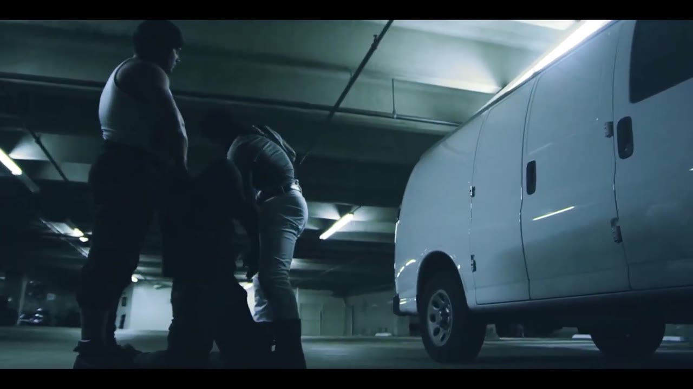
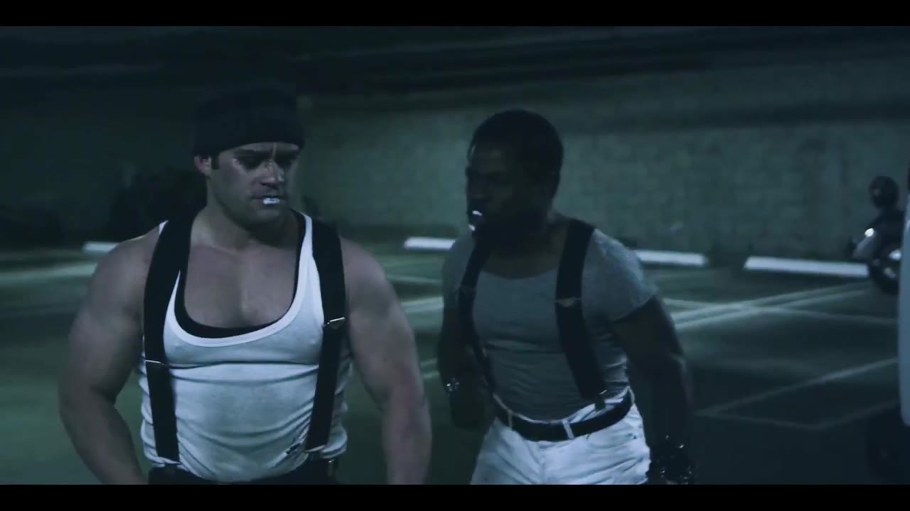
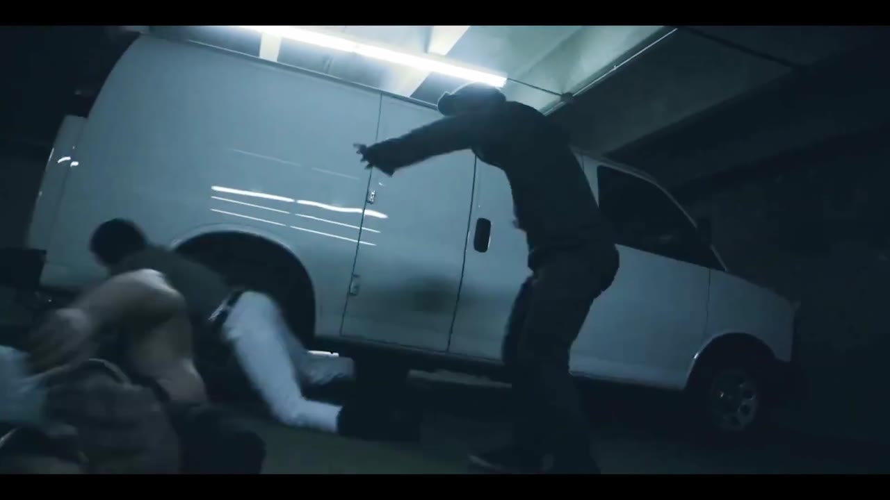
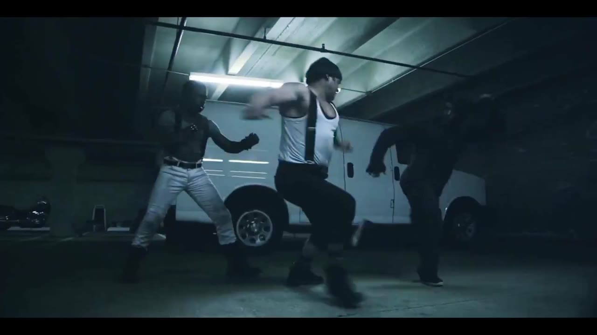
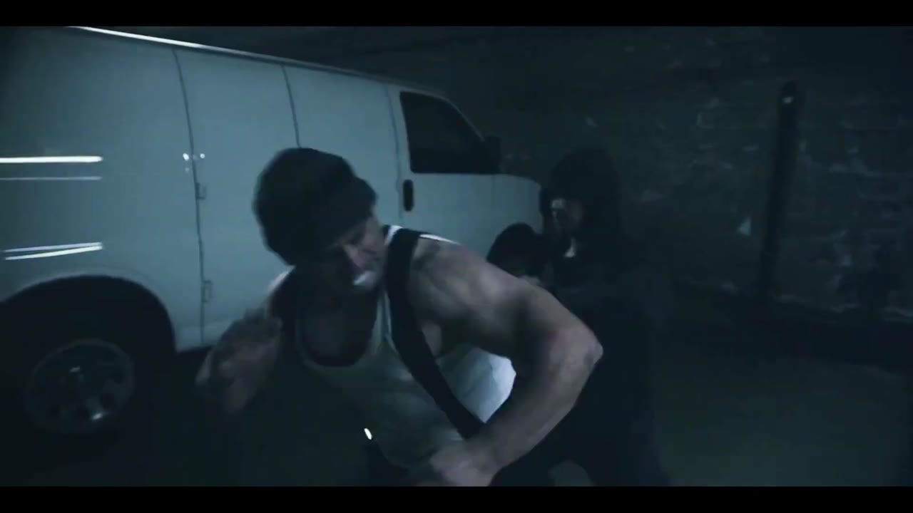
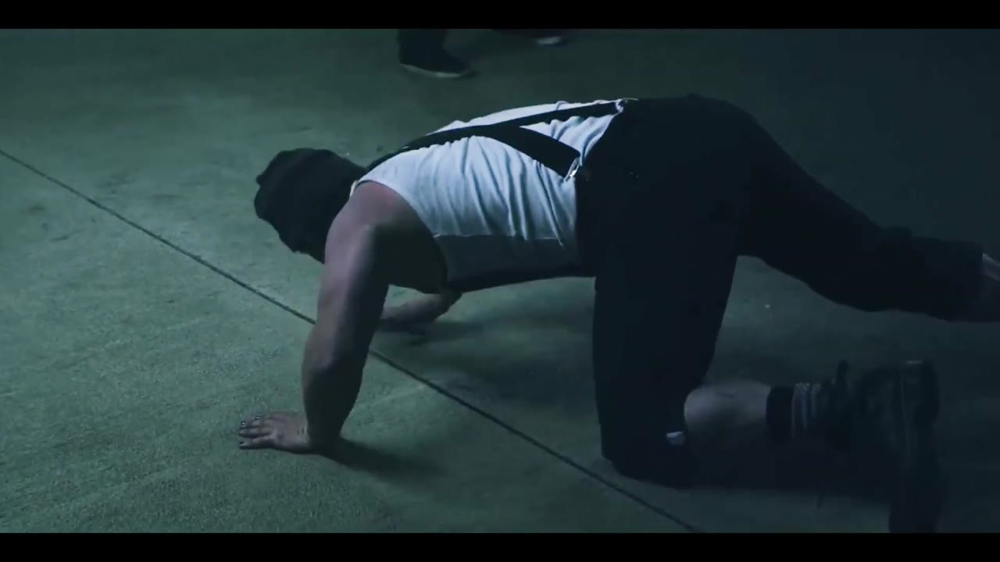
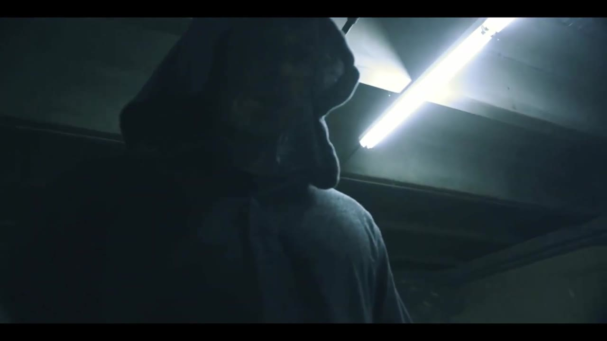
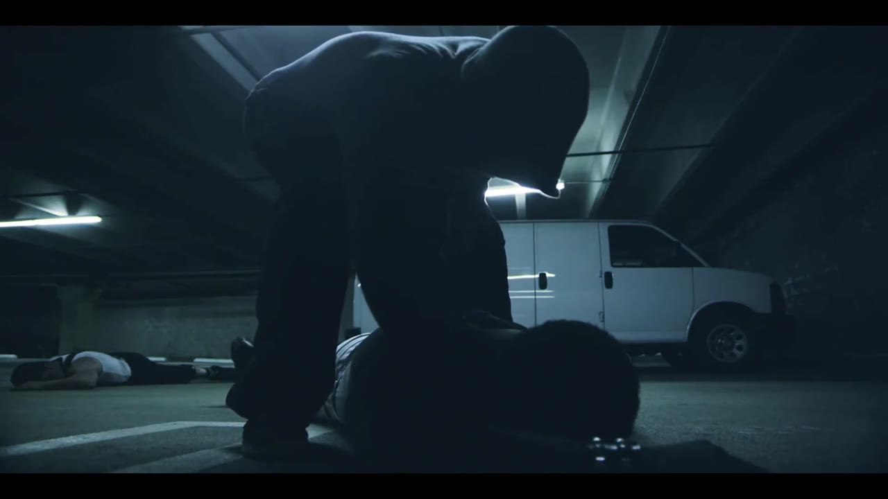

No big speech. No sword. Just a parking garage at night, a white van, and three guys who know how to sell a hit.

It's the fight from ***GLITCH***, the teaser I produced with director **Garrett Warren**. I wrote about the teaser and where it led back in October. This time I want to slow down and walk through the fight itself.

*Here they come. Frame from the [GLITCH teaser](https://www.youtube.com/watch?v=uGJ_VsZp0dI), written and directed by Garrett Warren.*

## The numbers

- **2 minutes, 34 seconds**: the whole teaser.
- **About 1 minute, 30 seconds** of that is fight, from the first approach to the last man down.
- **3** fighters on screen: me, **Samuel Jaye Paul** and **Matthew Shadden**.
- **1** person in charge of every move: Garrett, who wrote it, directed it and choreographed the fight.

## Who designed it

Garrett is a stunt coordinator, second unit director and director.

His IMDb lists **220** credits. His known-for list includes *Logan*, *Avatar* and *Avatar: Fire and Ash*.

On the [Studio 22 podcast](https://omny.fm/shows/studio-22/garrett-warren-full-audio-pod-1), he's introduced as the stunt coordinator and second unit director on the *Avatar* films, working with James Cameron.

So when Garrett lays out a garage fight, every step has a reason.

## Beat 1: The walk-up

The fight starts before anyone swings.

Two men in white tank tops and suspenders walk toward the van. Wide shot. Hard fluorescent light. Lots of empty concrete.

That space matters. It tells you nobody is coming to help.

*The suspenders crew. Frame from the [GLITCH teaser](https://www.youtube.com/watch?v=uGJ_VsZp0dI).*

## Beat 2: The van becomes a weapon

The van isn't just set dressing. It's part of the choreography.

Bodies hit it. Bodies roll off it. One guy ends up slammed across the hood.

*Into the van. Frame from the [GLITCH teaser](https://www.youtube.com/watch?v=uGJ_VsZp0dI).*

For a stunt performer, a van is a gift. It gives you something solid to react against. Every impact reads on camera because the metal moves and the sound lands.

## Beat 3: Two on one

Now it's a real fight.

Strikes come from two directions. The camera stays wide enough so you can see both attackers. That's on purpose. If you cut too tight in a two-on-one, the audience loses track of who's where.

*Mid-air. Frame from the [GLITCH teaser](https://www.youtube.com/watch?v=uGJ_VsZp0dI).*

*Up against the van. Frame from the [GLITCH teaser](https://www.youtube.com/watch?v=uGJ_VsZp0dI).*

## Beat 4: The floor

Every good fight has a moment where somebody's in real trouble.

Here, one fighter ends up on his hands and knees on the concrete, trying to get up.

*Down, not out yet. Frame from the [GLITCH teaser](https://www.youtube.com/watch?v=uGJ_VsZp0dI).*

That crawl is acting, not just stunts. The fight only works if you believe it hurts.

## Beat 5: Lights and shadow

Then the hood comes back into the frame. The light changes. The overhead tubes blow out behind him.

*Under the lights. Frame from the [GLITCH teaser](https://www.youtube.com/watch?v=uGJ_VsZp0dI).*

*The aftermath. Frame from the [GLITCH teaser](https://www.youtube.com/watch?v=uGJ_VsZp0dI).*

## Watch the fight

The video below starts right where the fight begins.

<iframe src="https://www.youtube-nocookie.com/embed/uGJ_VsZp0dI?start=23" title="GLITCH teaser trailer, fight scene" style="position:absolute;top:0;left:0;width:100%;height:100%;border:0;" allow="accelerometer; clipboard-write; encrypted-media; gyroscope; picture-in-picture" allowfullscreen loading="lazy"></iframe>

*[GLITCH Teaser Trailer](https://www.youtube.com/watch?v=uGJ_VsZp0dI), written and directed by Garrett Warren. Uploaded to my channel **January 1, 2021**.*

## The two guys I fought

**Samuel Jaye Paul** (billed on IMDb as Samuel J. Paul) is a stunt performer and actor. IMDb lists **118** credits. His known-for list includes *Black Panther*, *Black Panther: Wakanda Forever* and *The Man from Toronto*.

**Matthew Shadden** was a stunt performer too. IMDb lists **67** credits, with *Divergent*, *Godzilla* and *Scouts Guide to the Zombie Apocalypse* on his known-for list. When I re-posted the teaser in 2021, I put "RIP" next to Matt's name. Every time I watch this fight, I see him working.

## Who made GLITCH

Ranked by IMDb standing (STARmeter rank, then credit count):

1. **[Garrett Warren](https://www.imdb.com/name/nm0912836/)**, writer, director, fight choreographer · Instagram [@garrettxwarren](https://www.instagram.com/garrettxwarren/)
2. **[Kevin Tancharoen](https://www.imdb.com/name/nm1160495/)**, developed the GLITCH series with Garrett and me · Instagram [@ktanch](https://www.instagram.com/ktanch/)
3. **[Dan Liu](https://www.imdb.com/name/nm2364623/)**, editing and sound design
4. **[Samuel Jaye Paul](https://www.imdb.com/name/nm2698995/)**, star
5. **[McKay Stewart](https://www.imdb.com/name/nm1229683/)**, producer, star · Instagram [@mckaystewart](https://www.instagram.com/mckaystewart/)
6. **[Matthew Shadden](https://www.imdb.com/name/nm3259466/)**, star
7. **[Jaimie Bess](https://www.imdb.com/name/nm4567532/)**, set P.A., wardrobe assistant

Also on the crew, as listed in the teaser's end credits: **Clyde Bessey** (cinematography), **Megan Lian** (costume design), **Nar Levoni** and **Christian Aniceto** (camera operators), **Andrea Dondanville** (1st AC), **Steven Di Costanzo** (2nd AC), **Caitlan Nixon** (2nd AC / slate), **Lyndsie Duran** (make-up), **Michael Hardy** (motion graphics), **Peter Augustin** and **Sachi Ishida** (set photography) and **Chris Jai Alex** (EPK). Original score by **PARKRow** (A. Kemp, J. Cassidy, B. Liesegang, ASCAP). Made in association with **Origins of Light**.

## Sources

- **GLITCH Teaser Trailer (2021 upload, with credits):** [youtube.com/watch?v=uGJ_VsZp0dI](https://www.youtube.com/watch?v=uGJ_VsZp0dI)
- **Glitch - Teaser Trailer (2014 upload, credits):** [youtube.com/watch?v=Q905LzM_ukc](https://www.youtube.com/watch?v=Q905LzM_ukc)
- **Glitch (2013 project-channel upload, series development credit):** [youtube.com/watch?v=2Kaaw6yaZTU](https://www.youtube.com/watch?v=2Kaaw6yaZTU)
- **Garrett Warren, IMDb:** [nm0912836](https://www.imdb.com/name/nm0912836/)
- **Garrett Warren on Studio 22:** [omny.fm](https://omny.fm/shows/studio-22/garrett-warren-full-audio-pod-1)
- **Samuel J. Paul, IMDb:** [nm2698995](https://www.imdb.com/name/nm2698995/)
- **Matt Shadden, IMDb:** [nm3259466](https://www.imdb.com/name/nm3259466/)
- **Kevin Tancharoen, IMDb:** [nm1160495](https://www.imdb.com/name/nm1160495/); Instagram handle from his [X profile](https://x.com/KTANCH)
- **Dan Liu, IMDb:** [nm2364623](https://www.imdb.com/name/nm2364623/)
- **My earlier GLITCH post:** [GLITCH: My Fight Teaser With Director Garrett Warren](/2026/10/18/i-made-a-garage-fight-teaser-with-avatar-s-stunt-boss/)
