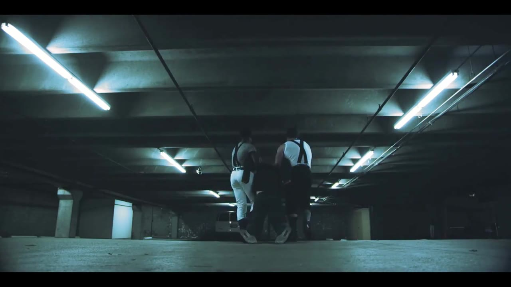
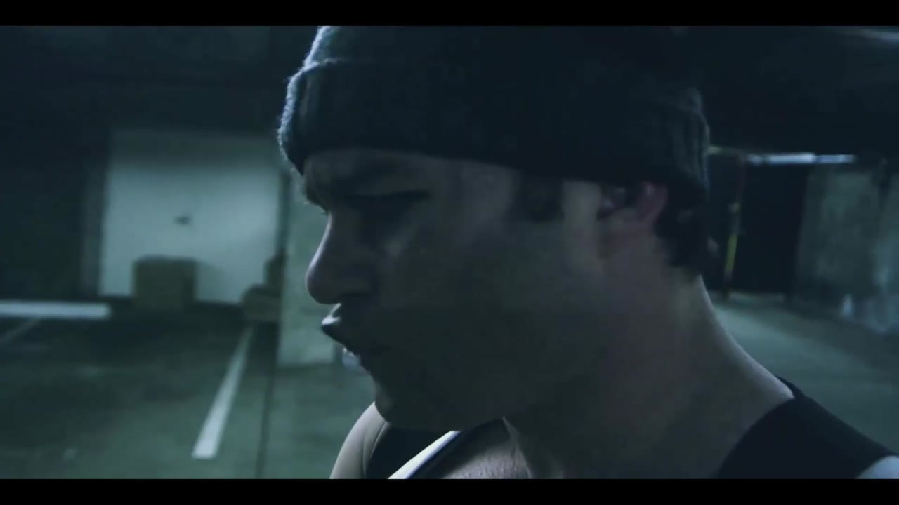
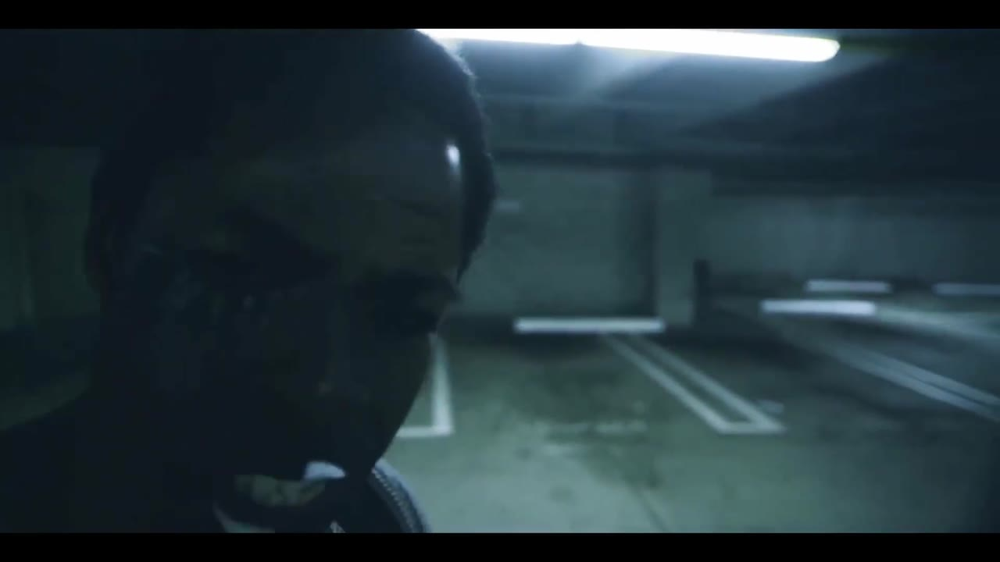
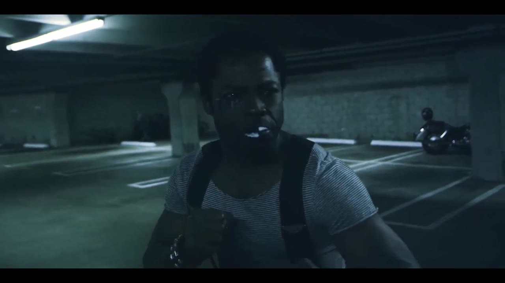
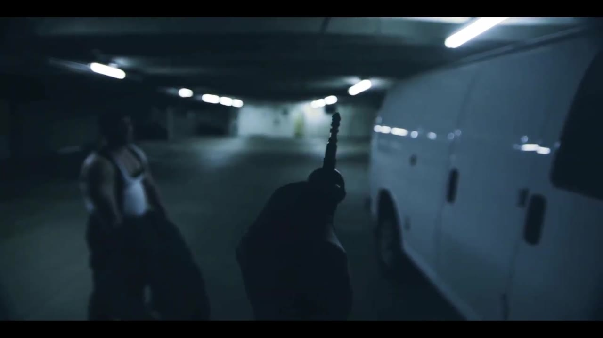
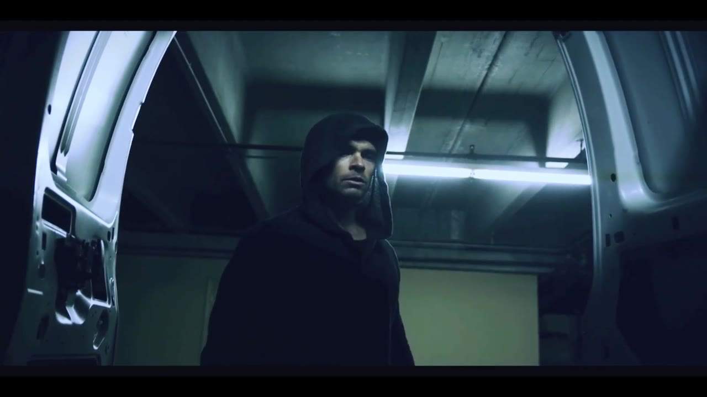
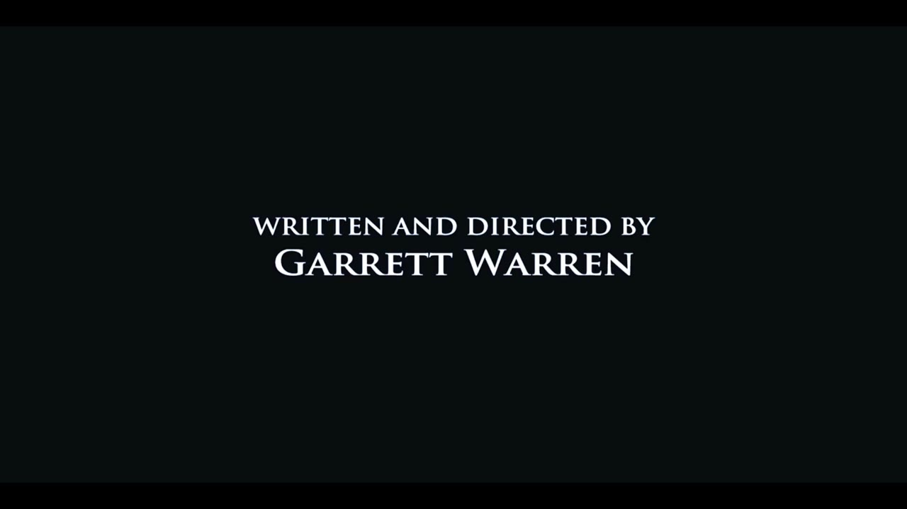
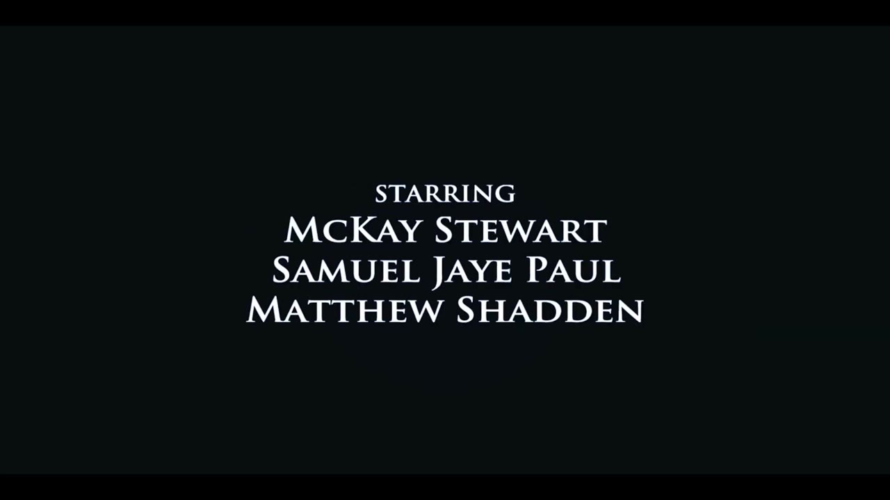

***GLITCH*** started as a pitch for a whole series.

Six clones. One mistake. One man sent to clean it up.

The piece we shot is only **2 minutes and 34 seconds** long. But it plays like a little short film. It has a world, a mood and a story you can feel, even before the first punch.

Last time I broke the fight down beat by beat. Today: the story behind it.

*The world of GLITCH. Frame from the [GLITCH teaser](https://www.youtube.com/watch?v=uGJ_VsZp0dI), written and directed by Garrett Warren.*

## The story

Here's the logline we posted with the very first upload, word for word:

> "A glitch in the genetic make-up of six clones sends a medical company into a frenzy trying to control their mistake. Allen Murphy is a sandman sent to track down and terminate the faulty individuals."

A sandman. A hunter who puts people to sleep for good.

That's the whole hook. And you get it from the look of the teaser alone: cold light, a hood, a van, nobody around.

*In the garage. Frame from the [GLITCH teaser](https://www.youtube.com/watch?v=uGJ_VsZp0dI).*

## Where it started: September 2013

**September 24, 2013.** The first cut went up on a YouTube channel we made just for the project, simply called **Glitch**.

The description said it was the teaser trailer for a web series in development by **Kevin Tancharoen**, **Garrett Warren** and me.

That channel has just **4** public videos today. The teaser has **175** views. Tiny numbers. Big plans.

*Mood first. Frame from the [GLITCH teaser](https://www.youtube.com/watch?v=uGJ_VsZp0dI).*

## The people who built the pitch

**Kevin Tancharoen** is a film and TV director. IMDb lists **86** credits. His known-for list includes *The Brothers Sun*, *The Book of Boba Fett* and *Warrior*.

**Garrett Warren** is a stunt coordinator, second unit director and director. IMDb lists **220** credits, with *Logan* and the *Avatar* films on his known-for list. He wrote and directed GLITCH and designed the fight.

**Dan Liu** cut it and built the sound. Today he's a TV director. IMDb lists *For All Mankind*, *Star Trek: Strange New Worlds* and *Star Trek: Picard* among his known-for titles.

That's a lot of talent for a garage teaser.

*Suspenders and a stare. Frame from the [GLITCH teaser](https://www.youtube.com/watch?v=uGJ_VsZp0dI).*

## Three uploads, one film

GLITCH has lived on YouTube three times:

- **September 24, 2013**: the project channel. Logline and development credit.
- **January 6, 2014**: my channel, with the first full credit list. It has **408** views.
- **January 1, 2021**: my channel again, retitled "Written and Directed by Garrett Warren." I added the original score credit, an IMDb link and "RIP" for Matt Shadden. It has **255** views.

Same **2:34** each time. Same garage. Same van.

*The van. Frame from the [GLITCH teaser](https://www.youtube.com/watch?v=uGJ_VsZp0dI).*

## The end card

My favorite frame might be the last one. The hood, framed by the open van doors.

It feels like the first shot of something bigger. That was always the idea.

*Framed by the van doors. Frame from the [GLITCH teaser](https://www.youtube.com/watch?v=uGJ_VsZp0dI).*

My [IMDb bio](https://www.imdb.com/name/nm1229683/bio/) still lists *Glitch* as a project in development.

## Watch it

<iframe src="https://www.youtube-nocookie.com/embed/uGJ_VsZp0dI" title="GLITCH teaser trailer" style="position:absolute;top:0;left:0;width:100%;height:100%;border:0;" allow="accelerometer; clipboard-write; encrypted-media; gyroscope; picture-in-picture" allowfullscreen loading="lazy"></iframe>

*[GLITCH Teaser Trailer](https://www.youtube.com/watch?v=uGJ_VsZp0dI), written and directed by Garrett Warren. Uploaded **January 1, 2021**.*

*The end credits. Frame from the [GLITCH teaser](https://www.youtube.com/watch?v=uGJ_VsZp0dI).*

## Who made GLITCH

Ranked by IMDb standing (STARmeter rank, then credit count):

1. **[Garrett Warren](https://www.imdb.com/name/nm0912836/)**, writer, director, fight choreographer · Instagram [@garrettxwarren](https://www.instagram.com/garrettxwarren/)
2. **[Kevin Tancharoen](https://www.imdb.com/name/nm1160495/)**, developed the GLITCH series with Garrett and me · Instagram [@ktanch](https://www.instagram.com/ktanch/)
3. **[Dan Liu](https://www.imdb.com/name/nm2364623/)**, editing and sound design
4. **[Samuel Jaye Paul](https://www.imdb.com/name/nm2698995/)**, star
5. **[McKay Stewart](https://www.imdb.com/name/nm1229683/)**, producer, star · Instagram [@mckaystewart](https://www.instagram.com/mckaystewart/)
6. **[Matthew Shadden](https://www.imdb.com/name/nm3259466/)**, star
7. **[Jaimie Bess](https://www.imdb.com/name/nm4567532/)**, set P.A., wardrobe assistant

Also on the crew, as listed in the end credits: **Clyde Bessey** (cinematography), **Megan Lian** (costume design), **Nar Levoni** and **Christian Aniceto** (camera operators), **Andrea Dondanville** (1st AC), **Steven Di Costanzo** (2nd AC), **Caitlan Nixon** (2nd AC / slate), **Lyndsie Duran** (make-up), **Michael Hardy** (motion graphics), **Peter Augustin** and **Sachi Ishida** (set photography) and **Chris Jai Alex** (EPK). Original score by **PARKRow** (A. Kemp, J. Cassidy, B. Liesegang, ASCAP). Made in association with **Origins of Light**.

*The cast card. Frame from the [GLITCH teaser](https://www.youtube.com/watch?v=uGJ_VsZp0dI).*

## Sources

- **Glitch (Sept 24, 2013, project channel, logline and development credit):** [youtube.com/watch?v=2Kaaw6yaZTU](https://www.youtube.com/watch?v=2Kaaw6yaZTU)
- **Glitch project channel:** [youtube.com/@glitchseriesbeta](https://www.youtube.com/@glitchseriesbeta)
- **Glitch - Teaser Trailer (Jan 6, 2014):** [youtube.com/watch?v=Q905LzM_ukc](https://www.youtube.com/watch?v=Q905LzM_ukc)
- **GLITCH Teaser Trailer (Jan 1, 2021):** [youtube.com/watch?v=uGJ_VsZp0dI](https://www.youtube.com/watch?v=uGJ_VsZp0dI)
- **Kevin Tancharoen, IMDb:** [nm1160495](https://www.imdb.com/name/nm1160495/); Instagram handle from his [X profile](https://x.com/KTANCH)
- **Garrett Warren, IMDb:** [nm0912836](https://www.imdb.com/name/nm0912836/)
- **Dan Liu, IMDb:** [nm2364623](https://www.imdb.com/name/nm2364623/)
- **My IMDb bio:** [imdb.com/name/nm1229683/bio](https://www.imdb.com/name/nm1229683/bio/)
