Back in October I told the story of ***West Side Swordy***: the idea, the website and the festival run.

This post is about two other things.

The **full film**, start to finish. And the **people** who made it, because a lot of them have gone on to some very big sets.

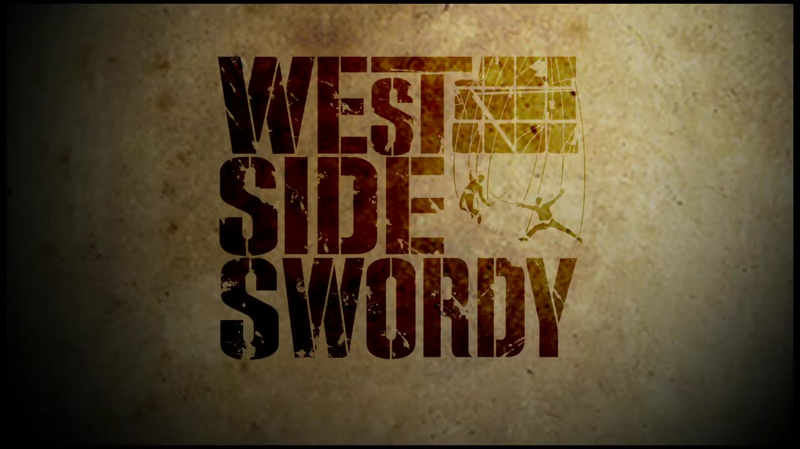
*The title card. Frame from [West Side Swordy](https://www.youtube.com/watch?v=LKlt_-3wqJI), directed by Dan Liu.*

## The quick facts

- **Runtime:** **8 minutes, 14 seconds** on YouTube. IMDb lists it as a **2015** U.S. short.
- **Director and editor:** **Dan Liu**
- **Written by:** me and Dan, per the YouTube credits
- **Produced by:** me. I also played **Riff**.
- **Music:** original score by **Leonard Bernstein**, from *West Side Story*. Credits music: "Try It Out" by **Skrillex**.
- **IMDb credit list:** **97** names, counting the thank-yous

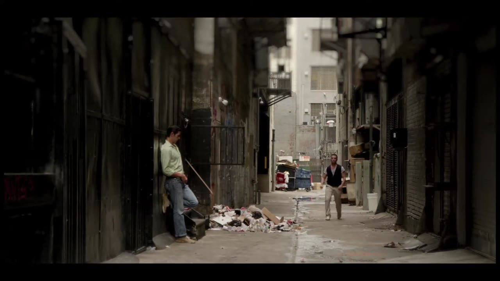
*The alley. Frame from [West Side Swordy](https://www.youtube.com/watch?v=LKlt_-3wqJI).*

## It started as 46 seconds

Before the short, there was a sword fight.

**January 26, 2014.** I posted "Sword Duel" on YouTube. **46 seconds.** Me and **Jason Brillantes**, crossing blades.

The copy on our Glitch project channel credits the edit to **Leo Kei Angelos**. Leo came back as **second unit director** on the short.

That clip was the test. The short was the real thing.

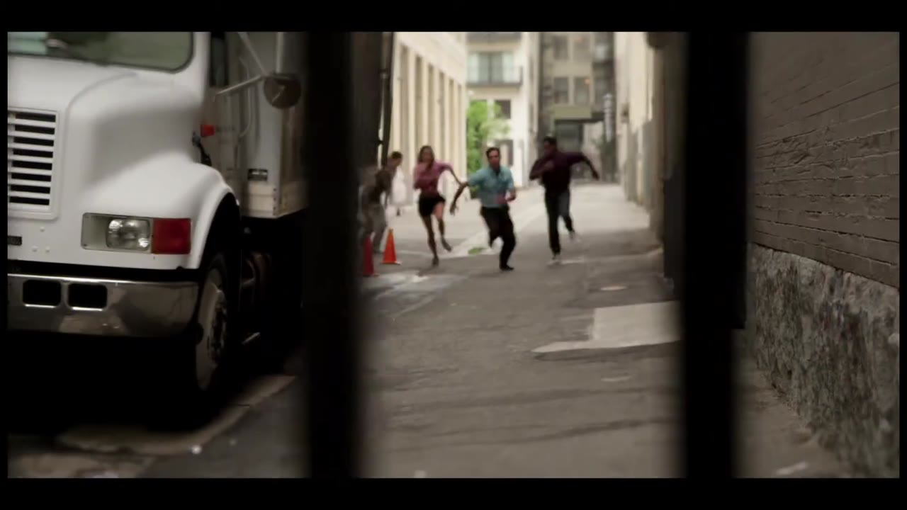
*The chase. Frame from [West Side Swordy](https://www.youtube.com/watch?v=LKlt_-3wqJI).*

## The film, in five moments

**1. The chase.** The Jets run the Sharks through the streets and over a fence.

**2. The warehouse.** Suddenly they're somewhere else. Dark. Smoky. A giant mau5 head watching.

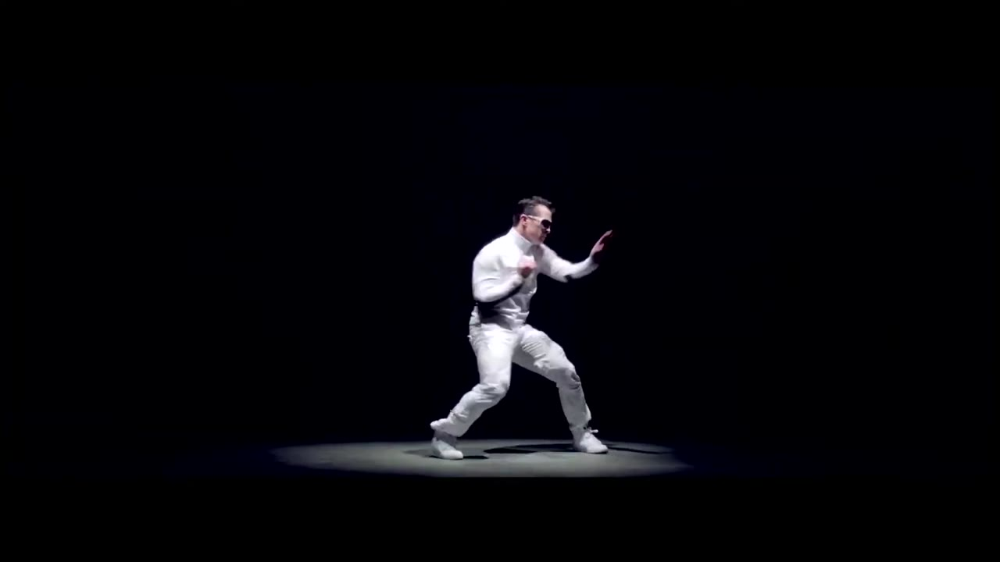
*One spotlight. Frame from [West Side Swordy](https://www.youtube.com/watch?v=LKlt_-3wqJI).*

**3. The dancers.** Backlit, in a line, moving to the beat.

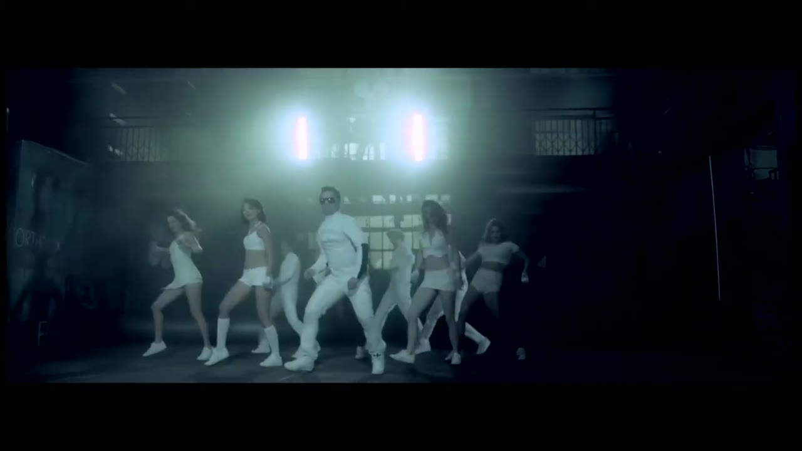
*Backlit. Frame from [West Side Swordy](https://www.youtube.com/watch?v=LKlt_-3wqJI).*

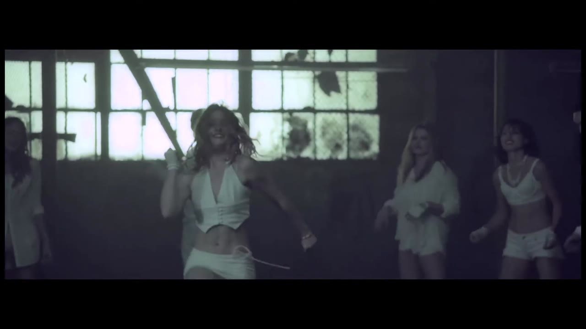
*Window light. Frame from [West Side Swordy](https://www.youtube.com/watch?v=LKlt_-3wqJI).*

**4. The swords.** Steel in the spotlight. **Nick Lanzisera** choreographed. I got a co-choreographer credit.

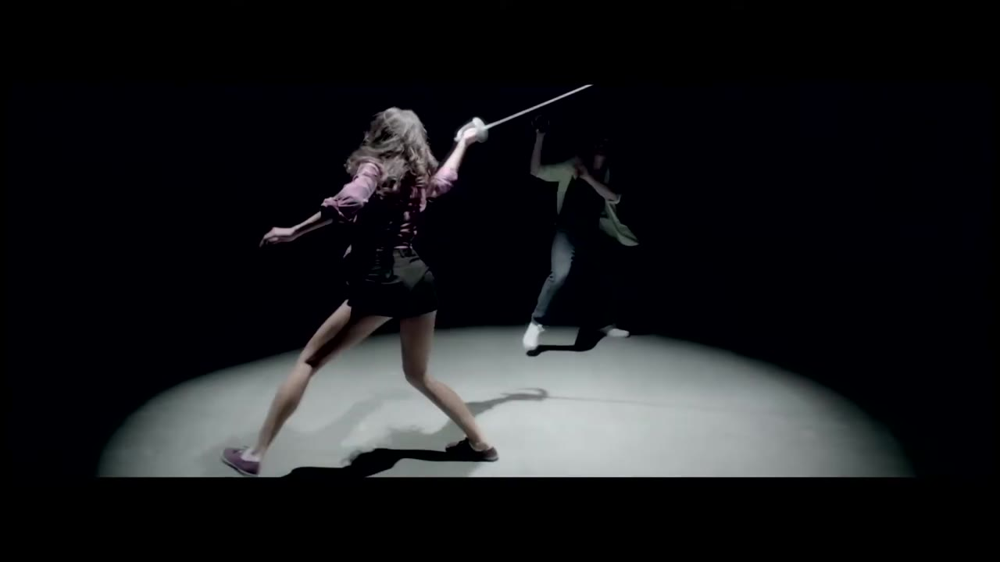
*Steel and spotlight. Frame from [West Side Swordy](https://www.youtube.com/watch?v=LKlt_-3wqJI).*

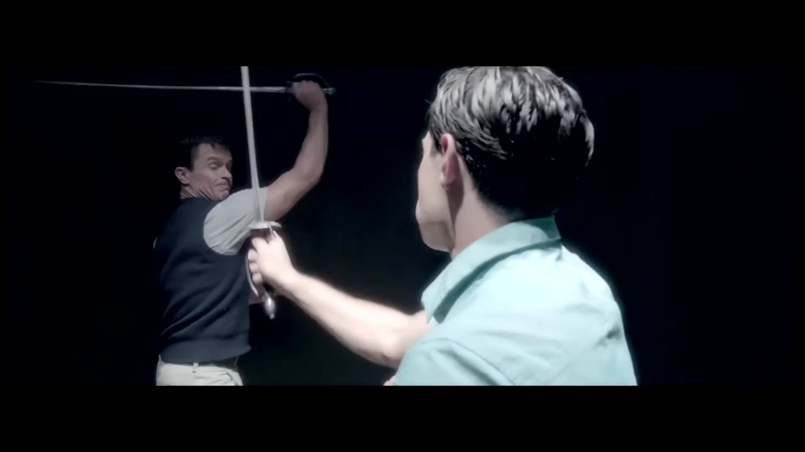
*Blades crossed. Frame from [West Side Swordy](https://www.youtube.com/watch?v=LKlt_-3wqJI).*

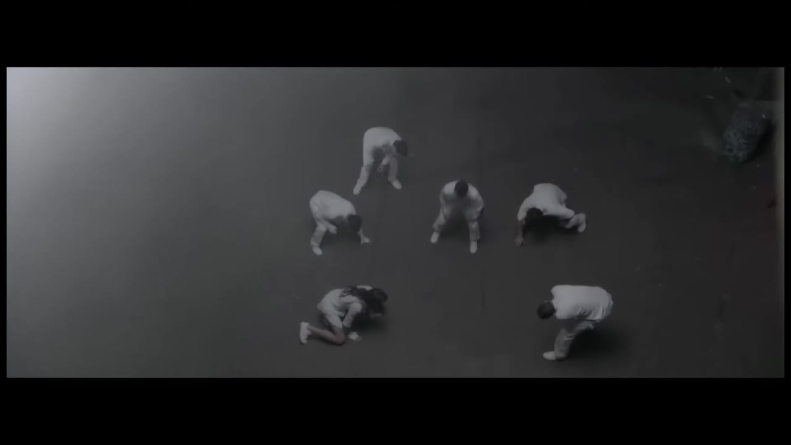
*From above. Frame from [West Side Swordy](https://www.youtube.com/watch?v=LKlt_-3wqJI).*

**5. Back on the street.** Back in the daylight.

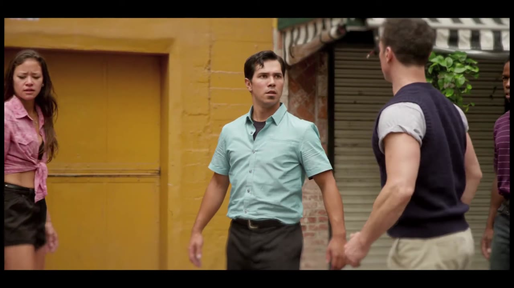
*Back in the real world. Frame from [West Side Swordy](https://www.youtube.com/watch?v=LKlt_-3wqJI).*

## Watch the whole thing

<iframe src="https://www.youtube-nocookie.com/embed/LKlt_-3wqJI" title="West Side Swordy" style="position:absolute;top:0;left:0;width:100%;height:100%;border:0;" allow="accelerometer; clipboard-write; encrypted-media; gyroscope; picture-in-picture" allowfullscreen loading="lazy"></iframe>

*[West Side Swordy, Directed by Dan Liu, Produced by McKay Stewart](https://www.youtube.com/watch?v=LKlt_-3wqJI), on my YouTube channel since **December 2018**. Want the trailer first? [Here it is](https://www.youtube.com/watch?v=wWf4WTp0RAA) (38 seconds, April 2015).*

## Where the swords went

**September 9, 2016.** I posted on X: "@westsideswordy offically selected for @umff and #kff16, woot!"

The film had its **world premiere** at **Dances With Films 2016**. And the **2016 Urban Mediamakers Film Festival** named it **Best International Music-Driven Short Film**.

## Where the crew went

This is my favorite part. Look at the known-for lists on IMDb now:

- **Solomon Brende** (our Gee-Tar) has over **100** credits. In June 2026 the *Ukiah Daily Journal* profiled him as Nicolas Cage's body double on *Spider-Noir*.
- **Michael Svitak** (camera operator): *Mercy*, *Hotel Artemis*, *Kate*.
- **James Hutchison III** (Ice): *Avengers: Endgame*, *Doom Patrol*, *Daredevil*.
- **Dan Liu** (director): *For All Mankind*, *Star Trek: Strange New Worlds*, *Star Trek: Picard*.
- **Jefferson Cox** (Action): *Wonder Woman 1984*, *Thunderbolts\**, *Army of the Dead*.
- **Samuel J. Paul** (Chino): *Black Panther*, *Black Panther: Wakanda Forever*.
- **John T. Connor** (cinematographer): *Top Gun: Maverick*, *Jack Ryan*, *Monster*.

A sword-and-dance short in a warehouse. Now look at them.

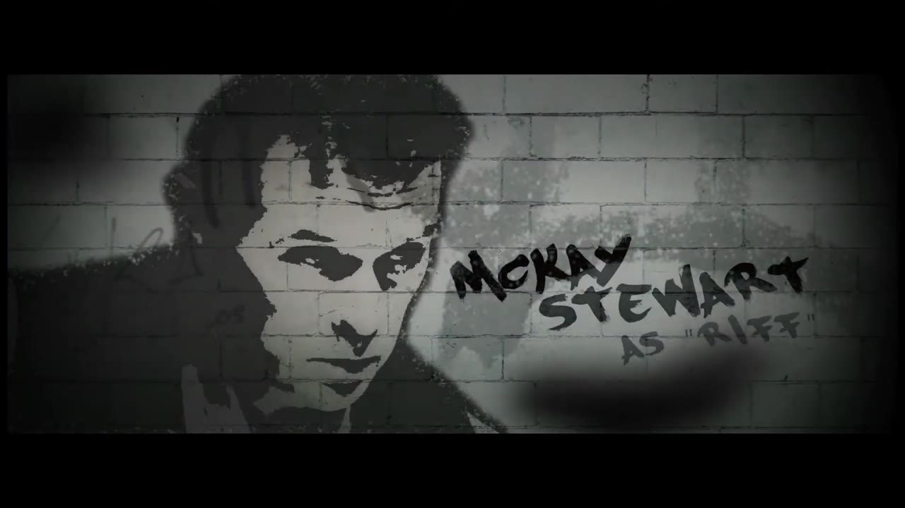
*My cast card. Frame from [West Side Swordy](https://www.youtube.com/watch?v=LKlt_-3wqJI).*

## Everyone who made it

Cast and crew from IMDb, ranked by IMDb standing (STARmeter rank first, then number of credits). Instagram handles appear only where I could confirm them through the person's own IMDb links or website.

1. **[Solomon Brende](https://www.imdb.com/name/nm3750462/)**, plays "Gee-Tar"
2. **[Michael Svitak](https://www.imdb.com/name/nm0841322/)**, camera operator · Instagram [@svitak](https://www.instagram.com/svitak/)
3. **[James Hutchison III](https://www.imdb.com/name/nm4581856/)**, plays "Ice"
4. **[Dan Liu](https://www.imdb.com/name/nm2364623/)**, director, editor
5. **[Jefferson Cox](https://www.imdb.com/name/nm3426315/)**, plays "Action"
6. **[Samuel J. Paul](https://www.imdb.com/name/nm2698995/)**, plays "Chino"
7. **[John T. Connor](https://www.imdb.com/name/nm0175423/)**, cinematographer
8. **[Rachel Apatoff](https://www.imdb.com/name/nm5009955/)**, additional costume designer
9. **[Hanna-Lee Sakakibara](https://www.imdb.com/name/nm2938790/)**, dancer
10. **[David Wachs](https://www.imdb.com/name/nm1640566/)**, dancer · Instagram [@iamdavidwachs](https://www.instagram.com/iamdavidwachs/)
11. **[McKay Stewart](https://www.imdb.com/name/nm1229683/)**, plays "Riff", writer, executive producer, producer, co-choreographer · Instagram [@mckaystewart](https://www.instagram.com/mckaystewart/)
12. **[Sarah "Smac" McCreanor](https://www.imdb.com/name/nm5964951/)**, dancer · Instagram [@smacmccreanor](https://www.instagram.com/smacmccreanor/)
13. **[Noah Fleder](https://www.imdb.com/name/nm5752625/)**, plays "Indio"
14. **[Brittney Bertier](https://www.imdb.com/name/nm5528749/)**, dancer · Instagram [@brittneybertier](https://www.instagram.com/brittneybertier/)
15. **[Darin Mangan](https://www.imdb.com/name/nm2209357/)**, camera operator
16. **[Bogdan Iofciulescu](https://www.imdb.com/name/nm1327178/)**, technocrane operator
17. **[Melissa Allen-Weiser](https://www.imdb.com/name/nm0020830/)**, property master
18. **[Jason Brillantes](https://www.imdb.com/name/nm4148611/)**, plays "Bernardo", stunts
19. **[Brandon M. Cox](https://www.imdb.com/name/nm1005975/)**, first assistant camera
20. **[Saige Walker](https://www.imdb.com/name/nm1928785/)**, plays "Deadmau5" · Instagram [@saigewalker](https://www.instagram.com/saigewalker/)
21. **[Nick Lanzisera](https://www.imdb.com/name/nm2980157/)**, choreographer
22. **[Amanda Nevarez](https://www.imdb.com/name/nm3888120/)**, first assistant director
23. **[Leo Kei Angelos](https://www.imdb.com/name/nm3269898/)**, second unit director
24. **[Nate Fu](https://www.imdb.com/name/nm3931436/)**, cinematographer
25. **[Alexander MacKay](https://www.imdb.com/name/nm6044258/)**, assistant costume designer
26. **[Tiffany Melvin](https://www.imdb.com/name/nm4154195/)**, sound editor, assistant editor
27. **[Harrison Bliss](https://www.imdb.com/name/nm4383205/)**, plays "Baby John"
28. **[Josh Brodis](https://www.imdb.com/name/nm3981496/)**, dancer
29. **[Shant Hamassian](https://www.imdb.com/name/nm2699353/)**, set photographer
30. **[Larry Sweet](https://www.imdb.com/name/nm0842282/)**, grip
31. **[Amanda Shelby](https://www.imdb.com/name/nm4835234/)**, production manager
32. **[Diana Eliazov](https://www.imdb.com/name/nm5243477/)**, second assistant camera
33. **[Jeff Parkhurst](https://www.imdb.com/name/nm5164508/)**, electrician
34. **[André Van Driessche](https://www.imdb.com/name/nm4842967/)**, plays "Deadmau5"
35. **[Marc Mellens](https://www.imdb.com/name/nm5498511/)**, sound designer
36. **[Fabricio DiSanto](https://www.imdb.com/name/nm0228282/)**, digital imaging technician-colorist
37. **[Brent Poe](https://www.imdb.com/name/nm0688099/)**, electrician
38. **[Stefan Duschaine](https://www.imdb.com/name/nm1122238/)**, electrician
39. **[Garret Curtis](https://www.imdb.com/name/nm3273858/)**, first assistant camera
40. **[Hilkiya Browne](https://www.imdb.com/name/nm5609754/)**, first assistant camera
41. **[Jaimie Bess](https://www.imdb.com/name/nm4567532/)**, plays "Anita"
42. **[Rocky Hollifield](https://www.imdb.com/name/nm4932346/)**, production assistant
43. **[Danny Hollifield](https://www.imdb.com/name/nm6051196/)**, production assistant
44. **[Brandyn-Ashley Anderson](https://www.imdb.com/name/nm4412855/)**, makeup artist
45. **[Makahla Ross](https://www.imdb.com/name/nm4700412/)**, dancer
46. **[Nik Nikides](https://www.imdb.com/name/nm5393209/)**, second assistant camera
47. **[Mimi Angel](https://www.imdb.com/name/nm5151309/)**, model, set photographer
48. **[Norma Mosqueda](https://www.imdb.com/name/nm5549530/)**, production assistant
49. **[Melissa Weiser](https://www.imdb.com/name/nm6051194/)**, property master
50. **[Candace Serini-t](https://www.imdb.com/name/nm8265406/)**, production assistant
51. **[Alexander Lombardo](https://www.imdb.com/name/nm6132327/)**, key art
52. **[Jay Andrino](https://www.imdb.com/name/nm6058471/)**, set photographer
53. **[Erin Rogers](https://www.imdb.com/name/nm6044259/)**, costume designer
54. **[Stephen Williams](https://www.imdb.com/name/nm3833557/)**, set photographer · Instagram [@metadogg](https://www.instagram.com/metadogg/)
55. **[Luis Rivera](https://www.imdb.com/name/nm6052250/)**, property designer
56. **[Dustin Evans](https://www.imdb.com/name/nm6050255/)**, technocrane
57. **[Mike Jones](https://www.imdb.com/name/nm6050250/)**, camera operator
58. **[Benjamin Cruz](https://www.imdb.com/name/nm6051198/)**, production assistant

For full credits click [HERE](https://www.imdb.com/title/tt3185554/)

## Sources

- **West Side Swordy (full film) on YouTube, with credits:** [youtube.com/watch?v=LKlt_-3wqJI](https://www.youtube.com/watch?v=LKlt_-3wqJI)
- **West Side Swordy Trailer (April 22, 2015):** [youtube.com/watch?v=wWf4WTp0RAA](https://www.youtube.com/watch?v=wWf4WTp0RAA)
- **Sword Duel (Jan 26, 2014):** [youtube.com/watch?v=78yY-nClzQg](https://www.youtube.com/watch?v=78yY-nClzQg) and the [Glitch-channel copy](https://www.youtube.com/watch?v=V-ufnMVZdcY) crediting Leo Kei Angelos
- **IMDb, West Side Swordy (2015):** [title page](https://www.imdb.com/title/tt3185554/) and [full credits](https://www.imdb.com/title/tt3185554/fullcredits/)
- **Festival post on X (Sept 9, 2016):** [x.com/mckaystewart/status/774406509027405828](https://x.com/mckaystewart/status/774406509027405828)
- **Dances With Films 2016:** [danceswithfilms.com/west-side-swordy](https://danceswithfilms.com/west-side-swordy/)
- **UMFF 2016 winners (PDF):** [umff.com](https://umff.com/assets/pdf/umff-winners-2016.pdf)
- **Solomon Brende profile:** Carole Brodsky, ["Your Friendly, Neighborhood Spider-Stuntman"](https://www.ukiahdailyjournal.com/2026/06/02/your-friendly-neighborhood-spider-stuntman/), *Ukiah Daily Journal*, June 2, 2026
- **Instagram handles:** from the official links on each person's IMDb page ([David Wachs](https://www.imdb.com/name/nm1640566/), [Saige Walker](https://www.imdb.com/name/nm1928785/), [Brittney Bertier](https://www.imdb.com/name/nm5528749/)) or their own sites ([michaelsvitak.com](https://michaelsvitak.com/), [smacmccreanor.com](https://www.smacmccreanor.com/), [stephen-williams.org](http://stephen-williams.org/))
- **My first West Side Swordy post:** [West Side Swordy!](/2026/10/08/holy-moly-west-side-swordy/)
