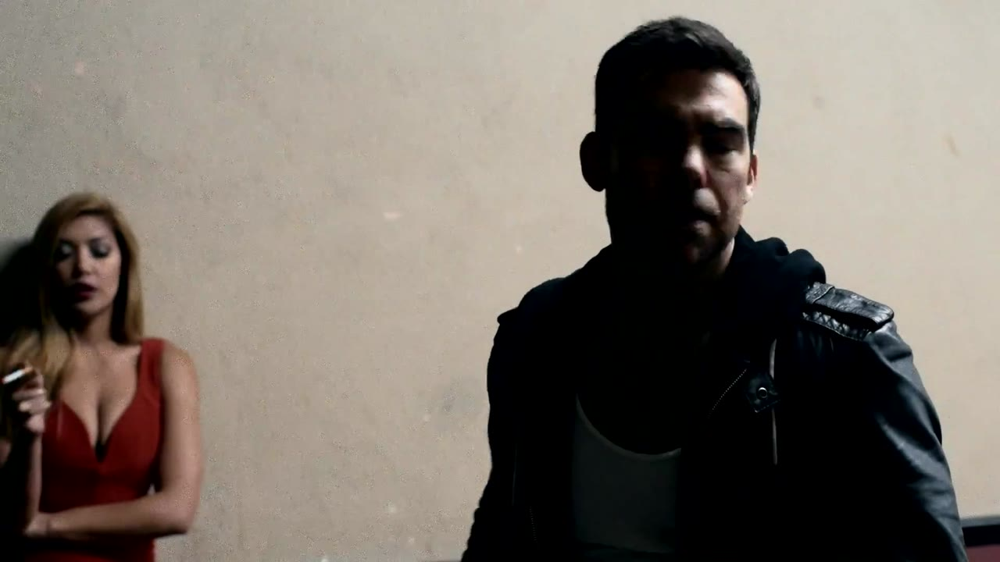
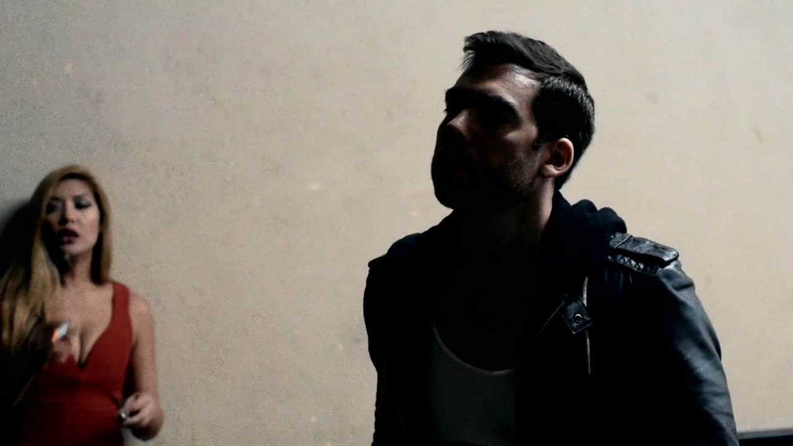
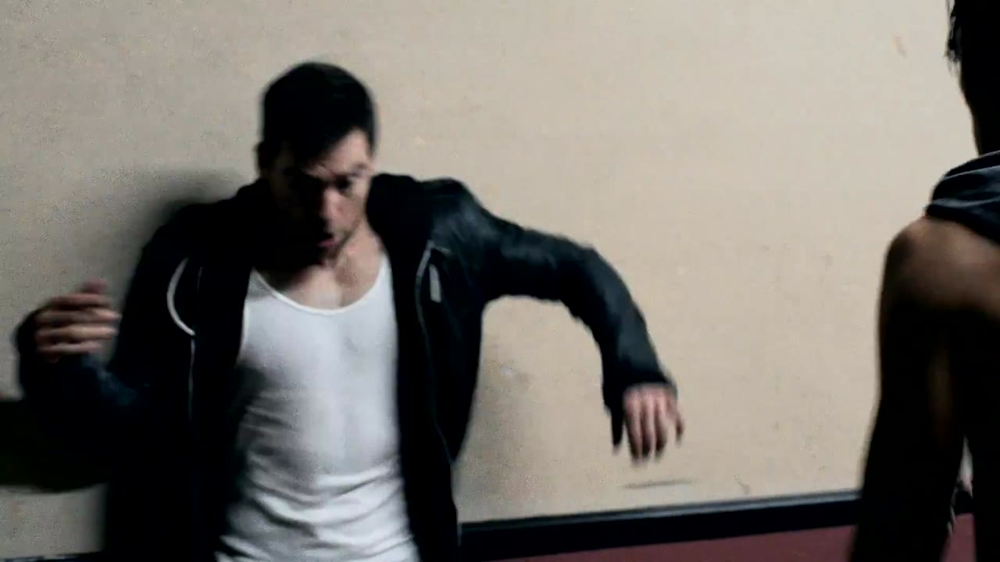
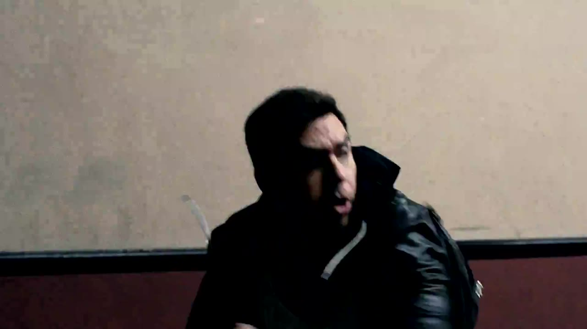
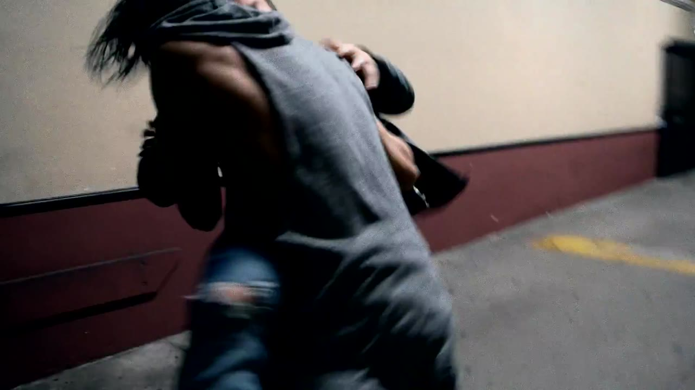
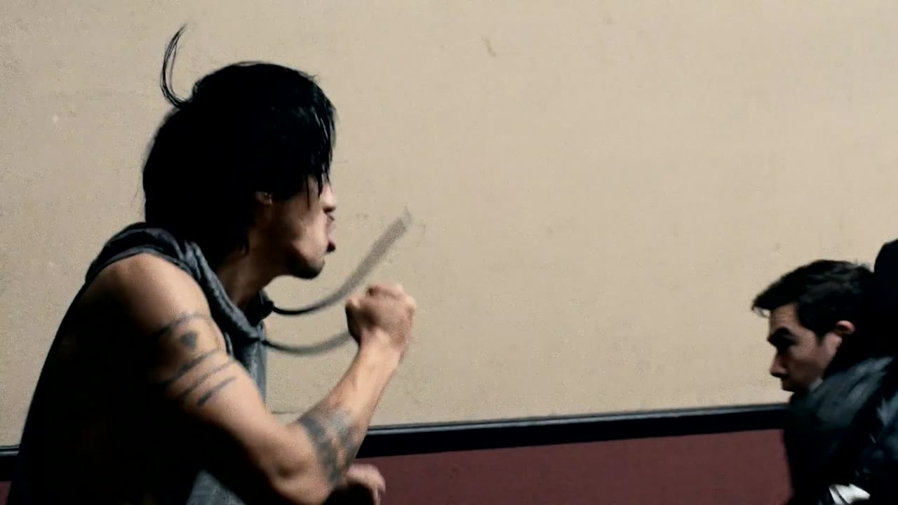
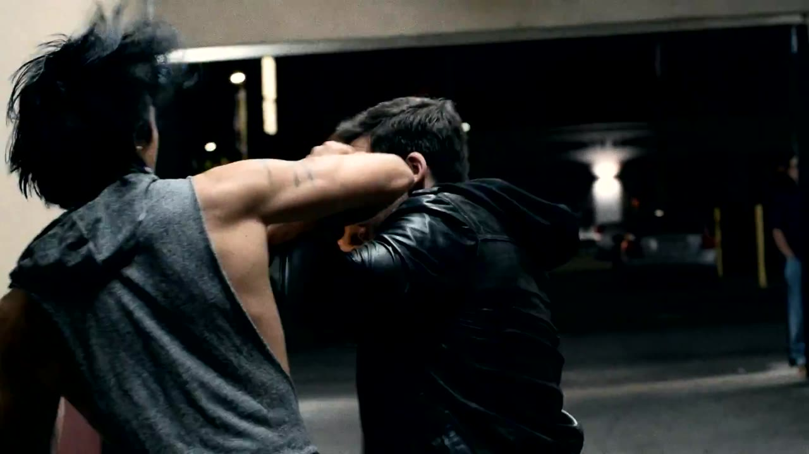
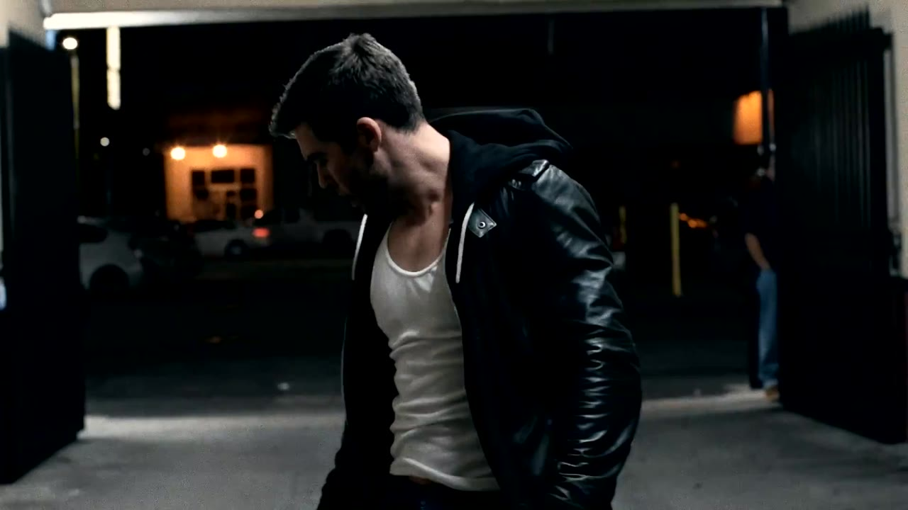
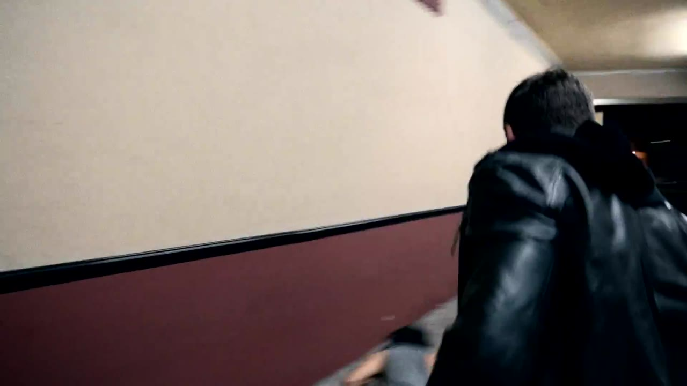

**29 seconds.**

That's the whole film. One wall. One woman in a red dress. Two men who really don't like each other.

It's called ***Down Tempo***, and I did almost every job on it: **writer, director, fight choreographer, camera and editor.**

I mentioned it briefly in my Wildcard Boxing post. It deserves its own.

*The calm before. Frame from [Down Tempo](https://www.youtube.com/watch?v=lpz1VZCGXZE), written, directed, shot and edited by McKay Stewart.*

## The quick facts

- **Runtime:** **29 seconds**
- **On YouTube:** **December 15, 2020**, in full HD (**1920 x 1080**)
- **Starring:** **Jasper Jeon** ([@jasperjeon](https://www.instagram.com/jasperjeon/)) and **David Wachs** ([@iamdavidwachs](https://www.instagram.com/iamdavidwachs/))
- **Scoring and sound design:** **Marc Mellens**
- **Everything else:** me

The next day I posted it on X with this:

> "We crushed it! They both did great with the fight and super easy to work with."

I still feel that way.

## The setup

The first few seconds are all waiting.

**David Wachs** in a black leather jacket, back to the wall. A woman in a red dress beside him, smoking. Nobody talks.

*Something's coming. Frame from [Down Tempo](https://www.youtube.com/watch?v=lpz1VZCGXZE).*

Then **Jasper Jeon** walks in. Sleeveless hoodie. Long hair. No hurry.

That slow start is the "down tempo." The fight hits harder because the opening is so still.

## The fight, beat by beat

**Beat 1: first contact.** The leather jacket slams back into the wall.

*Into the wall. Frame from [Down Tempo](https://www.youtube.com/watch?v=lpz1VZCGXZE).*

**Beat 2: the answer.** He swings back. The camera stays close so you feel it.

*The swing. Frame from [Down Tempo](https://www.youtube.com/watch?v=lpz1VZCGXZE).*

**Beat 3: the clinch.** They lock up and spin along the wall. That's where a fight stops looking like a dance and starts looking like a mess, in a good way.

*Locked up. Frame from [Down Tempo](https://www.youtube.com/watch?v=lpz1VZCGXZE).*

**Beat 4: guard up.** Hands up, eyes on each other. A breath.

*Guard up. Frame from [Down Tempo](https://www.youtube.com/watch?v=lpz1VZCGXZE).*

**Beat 5: the finish.** One last grab, and it's done.

*Last exchange. Frame from [Down Tempo](https://www.youtube.com/watch?v=lpz1VZCGXZE).*

**Beat 6: the walk.** The leather jacket heads out into the night.

*Out into the night. Frame from [Down Tempo](https://www.youtube.com/watch?v=lpz1VZCGXZE).*

## Why so short?

Short is hard.

In a feature, a fight can take its time. In **29 seconds**, every beat has to earn its spot. No extra punches. No filler.

That's why I like writing small pieces like this. It forces you to pick the best moment and cut the rest.

It also means the actors have to be ready. Jasper and David both came in sharp, and it shows.

## Watch it

<iframe src="https://www.youtube-nocookie.com/embed/lpz1VZCGXZE" title="Down Tempo feat. Jasper Jeon and David Wachs" style="position:absolute;top:0;left:0;width:100%;height:100%;border:0;" allow="accelerometer; clipboard-write; encrypted-media; gyroscope; picture-in-picture" allowfullscreen loading="lazy"></iframe>

*[Down Tempo feat. Jasper Jeon and David Wachs](https://www.youtube.com/watch?v=lpz1VZCGXZE) on my YouTube channel, uploaded **December 15, 2020**.*

## Where they are now

**Jasper Jeon** has been busy. IMDb lists **27** credits, including long runs on ***Big Bet*** (**9** episodes), ***The Silent Sea*** (**8**), ***Hellbound*** (**6**) and ***Money Heist: Korea - Joint Economic Area*** (**3**). He also worked on the video games *The Last of Us Part II* and *Star Wars Jedi: Fallen Order*.

**David Wachs** is an actor, producer and musician. IMDb lists **47** credits, including *Ryde*, *Capone* and *Out of Hand*. He also co-founded the production company **Toric Films** in **2013**.

**Marc Mellens** scored it and built the sound. IMDb lists **58** credits, including *Slipaway* and *Chances*. Marc also did sound design on my short *West Side Swordy*.

This wasn't our first fight together, either. Two years earlier, Jasper and David starred in my **Alley Brawl**. [That story is here.](/2026/10/16/i-choreographed-an-alley-fight-under-wildcard-boxing/)

*Walking it off. Frame from [Down Tempo](https://www.youtube.com/watch?v=lpz1VZCGXZE).*

## Who made Down Tempo

Ranked by IMDb standing (STARmeter rank, then credit count):

1. **[David Wachs](https://www.imdb.com/name/nm1640566/)**, star · Instagram [@iamdavidwachs](https://www.instagram.com/iamdavidwachs/)
2. **[McKay Stewart](https://www.imdb.com/name/nm1229683/)**, writer, director, fight choreographer, camera, editor · Instagram [@mckaystewart](https://www.instagram.com/mckaystewart/)
3. **[Jasper Jeon](https://www.imdb.com/name/nm6697708/)**, star · Instagram [@jasperjeon](https://www.instagram.com/jasperjeon/)
4. **[Marc Mellens](https://www.imdb.com/name/nm5498511/)**, scoring and sound design

## Sources

- **Down Tempo on YouTube, with credits:** [youtube.com/watch?v=lpz1VZCGXZE](https://www.youtube.com/watch?v=lpz1VZCGXZE)
- **My Down Tempo post on X (Dec 16, 2020):** [x.com/mckaystewart/status/1339256338841358337](https://x.com/mckaystewart/status/1339256338841358337)
- **Jasper Jeon, IMDb:** [nm6697708](https://www.imdb.com/name/nm6697708/)
- **David Wachs, IMDb (official Instagram link):** [nm1640566](https://www.imdb.com/name/nm1640566/)
- **Toric Films, About:** [toricfilms.com/about](https://toricfilms.com/about)
- **Marc Mellens, IMDb:** [nm5498511](https://www.imdb.com/name/nm5498511/)
- **West Side Swordy credits (Marc Mellens, sound design):** [IMDb](https://www.imdb.com/title/tt3185554/)
- **My Alley Brawl post:** [I Choreographed an Alley Fight Under Wildcard Boxing](/2026/10/16/i-choreographed-an-alley-fight-under-wildcard-boxing/)
